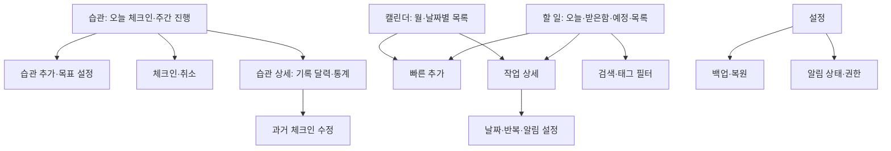

# 하루결 제품·화면 설계 v0.3

상태: 검토용 초안. 기준일: 2026-10-11.

## 1. 목표와 전제

습관을 정하고 매일 체크인하며 기록을 확인하는 흐름을 가장 먼저 완성한다.
할 일 기록·오늘 계획·일정 알림은 함께 제공한다.
사용자가 확정한 방향은 이름 ‘하루결’, 개인용·오프라인 우선, 습관·체크인 최우선, 완료·수량·시간 목표와 활기찬 달성 표시다.
나머지는 구현 전 조정 가능한 제안이다.

- 네트워크와 계정 없이 핵심 기능 전체가 동작한다.
- 기본 언어는 한국어, 날짜·시간 표시는 기기 설정을 따른다.
- 첫 실행에서 습관을 바로 만들 수 있다. 권한은 필요한 시점에 요청한다.
- 사용자에게 표시하는 이름은 ‘하루결’이다. 저장소 이름 `tool_ScheduleMng`는 유지한다. 패키지 ID·영문 표기는 미정이다.
- 기능을 참고하되 자체 화면과 자산을 사용한다. TickTick 연동·데이터 가져오기는 별도 요구사항이다.

## 2. 참고 기능과 단계

아래 목록은 공개 기능 소개를 바탕으로 분류한 범위다. TickTick 전체 동작이나 플랫폼별 제공 범위를 검증한 목록은 아니다.
M1은 첫 사용 가능한 버전, M2는 개인 생산성 확장, M3는 고급 보기, M4는 별도 서버·외부 연동 설계 단계다.

| 기능군 | 이 앱의 범위 | 단계 |
|---|---|---|
| 습관·체크인 | 완료·수량·시간 목표, 매일·선택 요일·주 N일, 날짜별 기록·수정, 기록 달력·연속 달성·달성률 | M1 최우선 |
| 할 일 관리 | 제목·메모·날짜·시간·우선순위, 생성·수정·완료·삭제·복구 | M1 |
| 분류 | 목록, 태그, 체크리스트, 수동 순서 | M1 |
| 기본 보기 | 받은함, 오늘, 예정, 전체, 완료, 휴지통, 검색 | M1 |
| 반복·알림 | 일·주·월·년 간격 반복, 요일 선택, 종료일, 여러 알림, 미루기 | M1 |
| 캘린더 | 월 보기와 선택 날짜의 일정 목록 | M1 |
| 백업·설정 | JSON 내보내기·복원, 밝게/어둡게/시스템 테마 | M1 |
| 집중 | 포모도로·스톱워치, 작업 연결, 세션 기록 | M2 |
| 위젯·종합 통계 | 오늘 할 일·빠른 추가, 완료·습관·집중 통합 통계 | M2 |
| 날짜 입력 | 한국어 자연어 날짜, 해석 결과 확인 후 적용 | M2 |
| 고급 캘린더 | 주·일 시간표, 일정 길이와 드래그 조정 | M3 |
| 고급 분류·보기 | 저장 필터, 칸반, 타임라인, 아이젠하워 매트릭스 | M3 |
| 중요 날짜 | 기념일·카운트다운 | M3 |
| 동기화·협업 | 로그인, 여러 기기, 공유 목록, 담당자 | M4 |
| 외부 서비스 | Google Calendar·캘린더 구독, 다른 앱 연동 | M4 |
| 확장 기능 | 지속 알림, 음성 입력·AI 요약, 자동화 API, 추가 테마 | M4에서 필요성 재검토 |

습관·체크인과 습관별 기본 통계는 M1 필수다. 집중 기능과 종합 통계는 M2다.
이메일 알림, 위치 알림, 데스크톱 전용 기능은 Android 개인용 초기 범위 밖이다.

## 3. 주요 사용 흐름

1. 습관 만들기: 습관 화면 → 추가 → 이름·목표 유형·목표량·주기·시작일·선택 알림 지정 → 저장.
2. 오늘 기록: 완료형은 체크인, 수량형은 빠른 더하기 또는 값 입력, 시간형은 분 단위 입력 → 진행률 반영 → 수정·초기화 가능.
3. 기록 확인: 습관 상세 → 월별 기록 달력 → 과거 날짜 선택 → 당시 목표와 기록량 확인·수정 → 통계 재계산.
4. 빠른 기록: 할 일 화면 → 추가 → 제목 입력 → 저장 → 받은함에 표시.
5. 오늘 계획: 오늘 화면 → 기한이 지난 일과 오늘 일을 확인 → 우선순위·시간 조정.
6. 반복 일정: 상세 화면 → 반복 주기와 알림 지정 → 이번 회차 완료 → 다음 회차 표시.
7. 일정 확인: 캘린더 → 날짜 선택 → 해당 날짜 작업 확인 → 상세에서 날짜 변경.
8. 데이터 보호: 설정 → 백업 저장 → 복원 파일 선택 → 습관·체크인을 포함한 항목 수 확인 → 교체 복원.

빠른 추가의 기본값은 받은함, 날짜 없음, 우선순위 없음이다.
캘린더에서 추가하면 선택 날짜를 미리 채우며, 저장 전에 변경할 수 있다.

## 4. 화면 구조

M1 하단 메뉴는 **습관 / 할 일 / 캘린더 / 설정** 네 개다. 첫 진입 화면은 습관이다. M2에서 집중을 추가한다.
할 일 화면의 상단 보기 선택에서 받은함·오늘·예정·전체·완료·휴지통·사용자 목록으로 이동한다.
태그 필터와 검색은 할 일 화면에서 연다. 미구현 기능을 빈 탭으로 노출하지 않는다.



첫 진입 습관 화면의 개념 배치:

```text
┌─────────────────────────┐
│ 하루결 · 습관        추가 │
│ 오늘 · 10월 11일         │
│ 오늘 대상                │
│ ◔ 독서       20/30분 기록│
│ ◔ 물 마시기    3/8잔 ＋1│
│ ✓ 스트레칭       취소    │
│ 주간 목표                │
│ ○ 운동      2/3일 체크인 │
│                    ＋    │
│ 습관  할 일 캘린더 설정   │
└─────────────────────────┘
```

| 화면 | 주요 조작·표시 |
|---|---|
| 습관 | 오늘 대상, 목표별 기록 버튼, 현재량/목표량, 주간 달성 일수, 달성 항목, 습관 추가 |
| 습관 편집 | 이름, 완료·수량·시간 유형, 목표량·단위, 매일·선택 요일·주 N일, 시작일, 알림, 보관 |
| 습관 상세 | 기록 달력, 과거 기록량 수정, 현재·최장 연속 달성, 기간 달성률 |
| 할 일 | 완료 체크, 제목·시간·우선순위, 목록 변경, 정렬, 추가 |
| 빠른 추가 | 제목 필수, 날짜·목록 선택, 상세 편집으로 이동 |
| 상세 | 메모, 체크리스트, 태그, 기한, 우선순위, 반복, 알림, 삭제 |
| 캘린더 | 월 이동, 날짜 선택, 작업 표시 점, 날짜별 작업 목록 |
| 설정 | 테마, 백업·복원, 알림 권한 상태, 앱 정보 |
| 휴지통 | 복구, 영구 삭제 확인, 전체 비우기 확인 |

빈 목록에는 짧은 안내와 추가 버튼을 표시한다. 검색 결과 없음, 저장 오류, 복원 오류를 구별한다.
스와이프는 보조 조작이다. 완료·삭제 기능은 버튼이나 메뉴로도 접근할 수 있어야 한다.
터치 영역은 최소 48dp, 글자 확대와 TalkBack을 지원하고 우선순위를 색상만으로 표현하지 않는다.

### 화면 분위기와 달성 표현

사용자가 선택한 방향은 달성 표시를 강조하는 활기찬 스타일이다. 아래 색상·표현은 디자인 제안이다.

- 밝은 배경, 둥근 습관 카드, 주황 포인트와 초록 달성 표시를 사용한다. 다크 테마도 같은 상태 의미를 유지한다.
- 카드에는 이름, 현재량/목표량, 진행 링, 기록 버튼을 함께 표시한다. 색상 외에 숫자·체크 아이콘·‘달성’ 문구를 사용한다.
- 오늘 요약은 ‘대상 습관 중 달성한 개수’를 표시한다. 부분 기록은 완료 수에 넣지 않고 각 카드 진행률로 보여준다.
- 목표에 처음 도달할 때 짧은 체크 전환과 선택적 진동을 제공한다. 초과 입력·재조회·화면 회전에서 축하 효과를 반복하지 않는다.
- 모션을 줄인 환경에서는 정적 달성 표시로 대체한다. 효과가 기록 버튼이나 화면 읽기를 막지 않는다.
- 미달성에는 ‘아직 기록이 없어요’ 같은 중립 문구를 사용한다. 강제 팝업·순위·포인트·가상 보상은 M1에 넣지 않는다.
- 아이콘·브랜드 색상·영문 표기는 시안에서 결정한다. 텍스트·버튼 대비는 시안 및 구현 단계에서 확인한다.

## 5. 사용자에게 보이는 규칙

- 완료형은 체크인·취소, 수량형은 목표량과 단위(예: 8잔·2km), 시간형은 목표 분(예: 30분)을 사용한다.
- 수량은 소수 둘째 자리까지 입력할 수 있다. 시간은 정수 분 단위로 수동 기록한다. 자동 타이머는 M2 집중 기능에서 다룬다.
- 수량형은 ＋1과 직접 입력, 시간형은 ‘시간 기록’으로 오늘 총량을 수정한다. 초기화는 0으로 되돌린다.
- 기록량이 해당 날짜 목표 이상이면 달성이다. 목표 미만인 부분 기록도 저장하고 목표 초과 실제량도 유지한다.
- 매일·선택 요일 목표는 그날의 목표량을 채우면 달성한다. 주 N일 목표는 월~일 중 목표량을 채운 서로 다른 N일이다.
- 완료형의 반복 요청은 중복 기록을 만들지 않는다. 수량·시간 수정은 화면의 최신 기록을 기준으로 적용한다.
- 시작일 이후 과거 기록은 달력에서 수정할 수 있다. 미래·시작일 이전·선택 요일 밖의 체크인은 허용하지 않는다.
- 목표량·주기 변경은 다음 날부터 적용한다. 변경 전후에 주 N일 목표가 포함되면 다음 월요일부터 적용한다. 과거 달성 판정은 당시 목표로 유지한다.
- 기록 단위를 보호하기 위해 생성 후 목표 유형·단위는 바꾸지 않는다. 다른 유형·단위는 새 습관으로 만든다.
- 습관 보관은 기록을 유지하고 이후 체크인·알림을 중단한다. 영구 삭제는 기록 삭제를 명시하고 확인받는다.
- 습관 알림은 선택 사항이다. 부분 기록 상태에는 알림을 유지하고 해당 날짜 목표를 달성하면 남은 알림을 취소한다. 알림 시각 개수는 사용자 답변 대기다.
- 주 N일 목표는 해당 주 목표를 채우면 남은 날짜 알림을 보내지 않는다. 취소하면 남은 미래 알림을 다시 계산한다.
- 습관 기록 달력과 작업 일정 캘린더는 구별한다. 습관 체크인이 작업 완료나 작업 생성으로 이어지지 않는다.
- 오늘: 미완료 작업 중 기한이 오늘인 작업과 기한이 지난 작업을 별도 구역으로 표시한다.
- 예정: 내일부터의 날짜 있는 미완료 작업을 날짜순으로 표시한다.
- 받은함: 받은함 목록의 미완료 작업. 날짜가 있어도 목록 소속은 유지한다.
- 전체: 휴지통을 제외한 모든 미완료 작업. 완료는 별도 보기에서 확인한다.
- 캘린더: 지정 기한 날짜에 표시한다. 날짜 없는 작업은 받은함·전체에서 확인한다.
- 검색: 제목과 메모를 대상으로 하며 기본은 미완료, 완료 포함은 선택 가능하다.
- 우선순위: 없음·낮음·중간·높음. 초기 정렬은 우선순위 높은 순, 같은 우선순위는 시간순, 이후 수동 순서다.
- 체크리스트 전체 체크가 부모 작업을 자동 완료하지 않는다. 완료는 사용자가 선택한다.
- 목록 삭제는 확인 후 소속 작업을 받은함으로 이동한다. 작업을 함께 삭제하지 않는다.
- 작업 삭제는 휴지통 이동이다. 자동 영구 삭제는 하지 않는다. 복구하면 알림을 다시 계산한다.
- 반복 완료·수정·되돌리기의 구체적인 규칙은 기술 설계 문서를 따른다.
- 알림이 꺼져도 작업 저장은 가능하다. 권한 상태와 알림 지연 가능성을 화면에서 알려준다.

## 6. M1 수용 기준

| 시나리오 | 통과 조건 |
|---|---|
| 습관 생성·체크인 | 완료·수량·시간 목표를 오프라인 생성·기록·수정·초기화 가능, 앱 재시작 후 부분 기록도 유지 |
| 목표량 정확성 | 소수 수량·분 기록, 목표 경계·초과량·음수 거부, 과거 목표량 변경 전후의 달성 판정 검증 |
| 목표·기록 정확성 | 매일·선택 요일·주 N일, 중복 요청, 과거 수정, 미래 금지, 목표 변경 전후 통계 검증 |
| 습관 통계 | 비대상 날짜가 연속 달성을 끊지 않음, 진행 중인 오늘·주를 실패로 판정하지 않음 |
| 습관 보호·알림 | 부분 기록 시 알림 유지·목표 달성 시 취소, 보관 후 중단, 복원 후 유형·단위·목표 이력·기록량 유지 |
| 달성 표현 | 부분·달성 상태를 색상 없이 구별, 큰 글씨·모션 감소 환경에서도 진행량 확인·수정 가능 |
| 오프라인 생성·수정 | 비행기 모드에서 저장·조회·완료 가능, 앱 재시작 후 내용 유지 |
| 빠른 추가 | 제목만 입력해 저장 가능, 공백 제목은 저장 차단 |
| 보기 정확성 | 오늘·지난 일·예정·날짜 없음·완료·휴지통이 정의대로 구분 |
| 반복 일정 | 월말·윤년·요일·종료일 테스트 통과, 완료 중복으로 회차 중복 생성 없음 |
| 알림 | 완료·삭제 후 취소, 수정·재부팅 후 재예약, 권한 거부 상태에서 앱 정상 동작 |
| 캘린더 | 월 전환·날짜 선택·작업 이동이 목록과 일치 |
| 복원 | 손상 파일은 기존 데이터 유지, 정상 파일은 확인 후 전체 교체, 관계·회차·알림 복구 |
| 접근성 | 큰 글씨에서 주요 조작 가능, TalkBack으로 생성·완료·삭제 가능 |

## 7. 참고 자료

- [TickTick 공식 홈페이지](https://ticktick.com/): 할 일·캘린더·집중·습관·카운트다운, 협업·동기화 등 기능군 확인.
- [TickTick 공식 기능 소개](https://ticktick.com/features): 목록·태그·필터·위젯·반복·알림 등 확인.

이 문서의 단계, 화면 구성, 데이터 규칙은 이 앱을 위한 제안이다. TickTick의 내부 설계를 추정하지 않는다.
