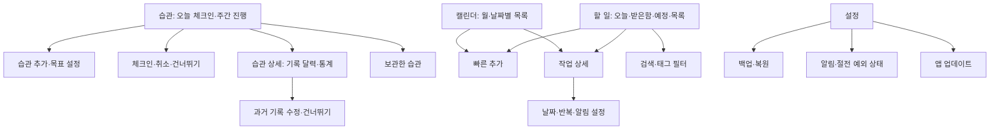

# 하루결 제품·화면 설계 v0.5

상태: 검토용 초안. 기준일: 2026-10-12.
색상·글자·그림 값은 [디자인 시스템](design-system.md), 화면별 구성·문구는 [화면 명세](screen-specs.md)가 기준이다. 아래 화면 분위기 절은 요약이다.
이 문서는 사용자에게 보이는 동작을 정한다. 저장·계산·OS 연동은 [기술 설계](technical-design.md)를 따른다.

## 1. 목표와 전제

습관을 정하고 매일 체크인하며 기록을 확인하는 흐름을 가장 먼저 완성한다.
할 일 기록·오늘 계획·일정 알림은 함께 제공한다.
사용자가 확정한 방향은 이름 ‘하루결’, 개인용·오프라인 우선, 습관·체크인 최우선, 완료·수량·시간 목표와 활기찬 달성 표시다.
추가 확정: 타이머와 수동 입력, 습관별 여러 시각 알림과 하루 한 번 요약, 시작일부터 모든 과거 기록 수정, 평문 백업, APK 직접 설치.
v0.5 확정: 쉬는 날 건너뛰기, GitHub 릴리스 기반 자동 업데이트, M1 기능을 나누지 않고 한 번에 구현.
우선 사용 기기는 갤럭시 S26 울트라다. 확인한 기기는 SM-S948N, Android 17(API 37), One UI 9.0, 화면 1440×3120(약 384dp 폭)이다.
나머지는 구현 전 조정 가능한 제안이다.

- 네트워크와 계정 없이 핵심 기능 전체가 동작한다. 네트워크는 앱 업데이트 확인·다운로드에만 쓴다.
- 기본 언어는 한국어, 날짜·시간 표시는 기기 설정을 따른다. 모든 날짜와 시각은 기기의 현재 시간대 기준이다.
- 첫 실행에서 습관을 바로 만들 수 있다. 권한은 필요한 시점에 요청한다.
- 사용자에게 표시하는 이름은 ‘하루결’, 영문 표기는 `Harugyeol`(릴리스 파일명·앱 정보), 패키지 ID는 `com.bossxor.harugyeol`이다. 저장소 이름 `tool_ScheduleMng`는 유지한다.
- 기능을 참고하되 자체 화면과 자산을 사용한다. TickTick 연동·데이터 가져오기는 별도 요구사항이다.

## 2. 참고 기능과 단계

아래 목록은 공개 기능 소개를 바탕으로 분류한 범위다. TickTick 전체 동작이나 플랫폼별 제공 범위를 검증한 목록은 아니다.
M1은 첫 사용 가능한 버전, M2는 개인 생산성 확장, M3는 고급 보기, M4는 별도 서버·외부 연동 설계 단계다.

| 기능군 | 이 앱의 범위 | 단계 |
|---|---|---|
| 습관·체크인 | 완료·수량·시간 목표, 매일·선택 요일·주 N일, 날짜별 기록·수정, 쉬는 날 건너뛰기, 기록 달력·연속 달성·달성률, 순서 변경, 보관·보관 해제 | M1 최우선 |
| 습관 타이머 | 시작·일시정지·재개·저장, 수동 시간 입력, 화면 종료 후 경과시간 복구 | M1 |
| 습관 알림 | 습관별 여러 시각, 하루 한 번 전체 습관 요약, 목표 달성·건너뛰기 후 개별 알림 중단 | M1 |
| 할 일 관리 | 제목·메모·날짜·시간·우선순위, 생성·수정·완료·삭제·복구 | M1 |
| 분류 | 목록, 태그, 체크리스트 | M1 |
| 기본 보기 | 받은함, 오늘, 예정, 전체, 완료, 휴지통, 검색 | M1 |
| 반복·알림 | 일·주·월·년 간격 반복, 요일 선택, 종료일, 여러 알림, 미루기 | M1 |
| 캘린더 | 월 보기와 선택 날짜의 일정 목록 | M1 |
| 백업·설정 | JSON 파일 내보내기·복원, 밝게/어둡게/시스템 테마 | M1 |
| 앱 업데이트 | GitHub 릴리스의 새 버전 확인·다운로드·설치 | M1 |
| 집중 | 포모도로·스톱워치, 작업 연결, 세션 기록 | M2 |
| 위젯·종합 통계 | 오늘 할 일·빠른 추가, 완료·습관·집중 통합 통계 | M2 |
| 날짜 입력 | 한국어 자연어 날짜, 해석 결과 확인 후 적용 | M2 |
| 고급 캘린더 | 주·일 시간표, 일정 길이와 드래그 조정 | M3 |
| 고급 분류·보기 | 저장 필터, 칸반, 타임라인, 아이젠하워 매트릭스, 할 일 수동 순서 | M3 |
| 중요 날짜 | 기념일·카운트다운 | M3 |
| 동기화·협업 | 로그인, 여러 기기, 공유 목록, 담당자 | M4 |
| 외부 서비스 | Google Calendar·캘린더 구독, 다른 앱 연동 | M4 |
| 확장 기능 | 지속 알림, 음성 입력·AI 요약, 자동화 API, 추가 테마 | M4에서 필요성 재검토 |

습관·체크인과 습관별 기본 통계는 M1 필수다. 집중 기능과 종합 통계는 M2다.
이메일 알림, 위치 알림, 데스크톱 전용 기능은 Android 개인용 초기 범위 밖이다.

## 3. 주요 사용 흐름

1. 습관 만들기: 습관 화면 → 추가 → 이름·목표 유형·목표량·주기·시작일·선택 알림 지정 → 저장.
2. 오늘 기록: 완료형은 체크인, 수량형은 빠른 더하기 또는 값 입력, 시간형은 타이머 또는 분 단위 입력 → 진행률 반영 → 수정·초기화 가능.
3. 쉬는 날: 습관 카드 메뉴 또는 기록 달력 → 건너뛰기 → 연속 달성 유지, 그날 개별 알림 중단.
4. 기록 확인: 습관 상세 → 월별 기록 달력 → 과거 날짜 선택 → 당시 목표와 기록량 확인·수정 → 통계 재계산.
5. 빠른 기록: 할 일 화면 → 추가 → 제목 입력 → 저장 → 받은함에 표시.
6. 오늘 계획: 오늘 화면 → 기한이 지난 일과 오늘 일을 확인 → 우선순위·시간 조정.
7. 반복 일정: 상세 화면 → 반복 주기와 알림 지정 → 이번 회차 완료 → 다음 회차 표시.
8. 일정 확인: 캘린더 → 날짜 선택 → 해당 날짜 작업 확인 → 상세에서 날짜 변경.
9. 데이터 보호: 설정 → 백업 저장 → 복원 파일 선택 → 습관·체크인을 포함한 항목 수 확인 → 교체 복원.
10. 업데이트: 앱 실행 → 새 버전 자동 다운로드 → 앱 내부 설치(실패 시 다운로드 폴더 APK로 설치) → 재실행 후 데이터 유지.

빠른 추가의 기본값은 받은함, 날짜 없음, 우선순위 없음이다.
캘린더에서 추가하면 선택 날짜를 미리 채우며, 저장 전에 변경할 수 있다.

## 4. 화면 구조

M1 하단 메뉴는 **습관 / 할 일 / 캘린더 / 설정** 네 개다. 첫 진입 화면은 습관이다. M2에서 집중을 추가한다.
할 일 화면의 상단 보기 선택에서 받은함·오늘·예정·전체·완료·휴지통·사용자 목록으로 이동한다.
태그 필터와 검색은 할 일 화면에서 연다. 미구현 기능을 빈 탭으로 노출하지 않는다.



첫 진입 습관 화면의 개념 배치:

```text
┌─────────────────────────┐
│ 하루결 · 습관        추가 │
│ 오늘 · 10월 12일         │
│ 오늘 대상                │
│ ◔ 독서       20/30분 기록│
│ ◔ 물 마시기    3/8잔 ＋1│
│ ✓ 스트레칭       취소    │
│ 주간 목표                │
│ ○ 운동      2/3일 체크인 │
│ 오늘 쉬는 습관 (2)     ▸ │
│                    ＋    │
│ 습관  할 일 캘린더 설정   │
└─────────────────────────┘
```

| 화면 | 주요 조작·표시 |
|---|---|
| 습관 | 이번 주 스티커 띠, 오늘 대상, 목표별 기록 버튼, 현재량/목표량, 실행 중 타이머, 주간 달성 일수, 달성 항목, 오늘 쉬는 습관(접힘), 편집 모드의 순서 변경, 습관 추가, 보관한 습관 메뉴 |
| 습관 편집 | 이름, 색상(4색)·그림, 완료·수량·시간 유형, 목표량·단위, 매일·선택 요일·주 N일, 시작일(오늘 또는 과거), 여러 알림 시각, 예약된 목표 변경 표시·취소, 보관 |
| 습관 상세 | 기록 달력(달성·부분·건너뜀·미기록 구분), 과거 기록량 수정·건너뛰기, 현재·최장 연속 달성, 표시 중인 달·전체 달성률, 건너뛴 날 수, 예약된 목표 변경 |
| 보관한 습관 | 보관 습관 목록, 기록 조회, 보관 해제, 영구 삭제 확인 |
| 습관 타이머 | 경과시간·저장된 오늘 기록 구분, 시작·일시정지·재개·저장·버리기 |
| 할 일 | 완료 체크, 제목·시간·우선순위, 목록 변경, 추가 |
| 빠른 추가 | 제목 필수, 날짜·목록 선택, 상세 편집으로 이동 |
| 상세 | 메모, 체크리스트, 태그, 기한, 우선순위, 반복, 알림, 삭제 |
| 캘린더 | 월 이동, 날짜 선택, 작업 표시 점, 날짜별 작업 목록 |
| 설정 | 테마, 달성 효과 진동, 백업·복원, 하루 요약 켜기·시각, 종일 작업 알림 시각, 알림 권한·절전 예외 상태, 업데이트(현재 버전·지금 확인·진행 상태), 오픈소스 라이선스, 앱 정보 |
| 스티커 모음 | 이번 달 스티커 수, 습관별 달성 수, 연속 달성 마일스톤(3·7·30·100일) |
| 휴지통 | 복구, 영구 삭제 확인, 전체 비우기 확인 |

빈 목록에는 짧은 안내와 추가 버튼을 표시한다. 검색 결과 없음, 저장 오류, 복원 오류를 구별한다.
스와이프는 보조 조작이다. 완료·삭제 기능은 버튼이나 메뉴로도 접근할 수 있어야 한다.
터치 영역은 최소 48dp, 글자 확대와 TalkBack을 지원하고 우선순위를 색상만으로 표현하지 않는다.

### 화면 분위기와 달성 표현

확정한 방향은 ‘스티커 컬렉션’이다. 원색 면과 굵은 윤곽선, 납작한 벡터 그림이 많은 활기찬 화면이며 달성하면 그림 스티커가 모인다.
색상·글자체·그림 규칙은 이 절이 기준이다. 세부 값은 시안에서 조정할 수 있다.

**색상**

- 원색 네 가지를 쓴다: 빨강 `#E24B4A`, 파랑 `#378ADD`, 노랑(주황) `#EF9F27`, 초록 `#639922`. 습관을 만들 때 이 중 하나를 고르며 카드·스티커·달력·알림 아이콘이 그 색을 따른다.
- 상태 의미는 고정한다: 초록은 달성, 점선 윤곽은 아직 기록 없음, 줄무늬는 건너뜀. 습관 색과 겹쳐도 상태는 문구·아이콘으로 구별한다.
- 밝은 모드: 따뜻한 흰 배경 `#FFFDF7`, 진한 윤곽선·글자 `#2C2C2A`. 어두운 모드: 배경 `#1B1B1F`, 윤곽선·글자 `#F4F1EA`.
- 노랑 위 글자는 짙은 갈색 `#412402`을 쓴다. 빨강·파랑·초록 위 흰 글자는 대비가 3.4~3.9:1이므로 큰 글자(주아 16sp 이상)에만 쓰고, 작은 글자는 흰색·연한 바탕 위에 짙은 색으로 쓴다. 어두운 모드에서는 같은 색 계열의 밝은 단계를 글씨·버튼에 쓴다.
- 큰 면의 원색은 한 화면에 많아야 둘만 쓴다. 나머지는 흰색과 윤곽선으로 둔다.

**글자체**

- 제목·습관 이름·큰 숫자·스티커 문구는 **주아**(Jua), 설명·메모·작은 글씨·입력 칸·알림 본문은 **Pretendard**를 쓴다. 둘 다 앱에 포함하며 인터넷이 없어도 같다.
- 작은 글씨(14sp 미만)에는 주아를 쓰지 않는다. 글자 확대 설정에서도 줄바꿈이 깨지지 않게 확인한다.
- 진행량(`20/30분`)은 가독성을 위해 Pretendard 굵은 글씨를 쓴다.

**그림**

- 납작한 벡터 스타일 하나로 통일한다. 단색 면과 굵은 윤곽선만 쓰고 그림자·질감·그라데이션은 쓰지 않는다.
- 습관 그림: 습관을 만들 때 고르는 그림 45개(독서, 물, 운동, 수면 등). 고르지 않으면 이름의 첫 글자를 원 안에 넣은 기본 그림을 쓴다.
- 스티커: 달성한 날 그 습관의 그림이 원형 스티커로 찍힌다. 마일스톤 스티커는 연속 달성 3·7·30·100일에 얻으며 모두 같은 형태에 숫자만 다르다.
- 상태 그림: 습관이 없을 때, 보관함이 비었을 때, 검색 결과가 없을 때, 전부 달성한 날의 큰 그림 각 1장.
- 그림은 상업적 사용이 허용된 무료 일러스트를 우선 쓰고, 맞는 것이 없을 때만 AI로 생성해 선별한다. 출처와 라이선스를 저장소에 기록한다.

**배치와 표현**

- 습관 화면 위쪽에 ‘이번 주 스티커’ 띠를 둔다. 달성은 색칠된 원, 아직 얻지 못한 자리는 점선 원으로 보인다.
- 습관 카드는 왼쪽 큰 원형 그림, 이름, 현재량/목표량, 오른쪽 기록 버튼으로 구성한다. 달성하면 카드 배경이 연한 초록으로 바뀌고 ‘달성’ 문구와 스티커가 붙는다.
- 오늘 요약은 ‘대상 습관 중 달성한 개수’를 표시한다. 부분 기록은 완료 수에 넣지 않고 각 카드 진행률로 보여준다. 건너뛴 습관은 대상 수에서 뺀다.
- 하단 메뉴 아이콘도 같은 윤곽선 스타일로 그리며 선택된 항목만 원색으로 채운다.
- 색상 외에 숫자·체크 아이콘·‘달성’ 문구로도 상태를 구별한다. 글자와 배경의 대비는 시안에서 확인한다.

**움직임**

- 목표에 처음 도달할 때 스티커가 ‘탁’ 찍히는 짧은 전환과 선택적 진동을 한 번 제공한다. 초과 입력·재조회·화면 회전에서 반복하지 않는다.
- 평소 화면은 움직이지 않는다. 모션을 줄인 환경에서는 정적 스티커 표시로 대체한다. 효과가 기록 버튼이나 화면 읽기를 막지 않는다.

**보상의 경계**

- 스티커는 달성 기록을 그림으로 보여주는 것이다. 포인트·순위·상점·가상 화폐·강제 팝업은 M1에 넣지 않는다.
- 스티커와 마일스톤은 저장하지 않고 기록에서 계산한다. 과거 기록을 고치면 스티커도 함께 바뀐다.
- 미달성에는 ‘아직 기록이 없어요’ 같은 중립 문구를 쓴다. 건너뛴 날은 스티커 없이 줄무늬 원으로 표시한다.

## 5. 사용자에게 보이는 규칙

### 습관 기록

- 완료형은 체크인·취소, 수량형은 목표량과 단위(예: 8잔·2km), 시간형은 목표 분(예: 30분)을 사용한다.
- 수량은 소수 둘째 자리까지 입력할 수 있다. 시간은 타이머 측정과 수동 정수 분 입력을 함께 제공한다.
- 수량형은 ＋1과 직접 입력, 시간형은 ‘시간 기록’으로 오늘 총량을 수정한다. 초기화는 0으로 되돌린다.
- ＋1은 누른 횟수만큼 더한다. 빠르게 연달아 눌러도 모두 반영한다. 직접 입력·초기화는 총량을 그 값으로 바꾼다.
- 완료형 체크인은 여러 번 눌러도 기록이 하나다.
- 기록량이 해당 날짜 목표 이상이면 달성이다. 목표 미만인 부분 기록도 저장하고 목표 초과 실제량도 유지한다.
- 매일·선택 요일 목표는 그날의 목표량을 채우면 달성한다. 주 N일 목표는 월~일 중 목표량을 채운 서로 다른 N일이다.
- 시작일부터 오늘까지 모든 기록은 달력에서 수정할 수 있다. 최근 며칠 제한은 없다. 미래·시작일 이전·선택 요일 밖의 기록은 허용하지 않는다.
- 습관 기록 달력과 작업 일정 캘린더는 구별한다. 습관 체크인이 작업 완료나 작업 생성으로 이어지지 않는다.

### 습관 설정·관리

- 시작일은 오늘 또는 과거 날짜다. 미래 시작은 M1에서 허용하지 않는다. 시작일은 생성 후 바꾸지 않는다.
- 기록 단위를 보호하기 위해 생성 후 목표 유형·단위는 바꾸지 않는다. 다른 유형·단위는 새 습관으로 만든다.
- 아직 기록·건너뛰기가 하나도 없는 습관은 목표를 바꾸면 즉시 적용한다. 만든 직후의 오타를 바로 고칠 수 있다.
- 기록이 있는 습관의 목표량·주기 변경은 다음 날부터 적용한다. 변경 전후에 주 N일 목표가 포함되면 다음 월요일부터 적용한다. 과거 달성 판정은 당시 목표로 유지한다.
- 아직 적용되지 않은 변경은 습관 상세와 편집 화면에 ‘10월 13일부터 8잔’처럼 표시하고 취소할 수 있다. 다시 편집하면 예약된 변경을 새 내용으로 바꾼다.
- 습관 화면의 편집 모드에서 끌어서 놓기 또는 위·아래 버튼으로 순서를 바꾼다. 같은 순서를 각 구역에 적용한다.
- 오늘이 대상 요일이 아닌 선택 요일 습관은 ‘오늘 쉬는 습관’ 접힌 구역에 표시한다. 기록 버튼과 타이머가 없고 탭하면 상세를 연다.
- 주 N일 습관은 매일 대상이다. 그 주 목표를 채우면 달성 구역으로 옮긴다.
- 보관은 기록을 유지하고 이후 체크인·알림을 중단한다. 보관한 습관은 습관 화면 메뉴의 ‘보관한 습관’에서 조회한다.
- 보관 해제하면 다시 오늘 화면과 알림에 나타난다. 보관 기간의 대상 날짜는 미기록으로 남으며 과거 수정·건너뛰기로 보정할 수 있다.
- 영구 삭제는 기록 삭제를 명시하고 확인받는다.

### 쉬는 날 건너뛰기

- 대상 날짜를 ‘건너뜀’으로 표시할 수 있다. 오늘과 과거 날짜만 가능하며 횟수 제한은 없다.
- 기록량이 0인 날만 건너뛸 수 있다. 건너뛴 날에 기록하면 건너뛰기가 해제된다.
- 건너뛴 날은 연속 달성을 끊지 않고 달성률 계산에서 빠진다. 비대상 요일과 같은 취급이다.
- 주 N일 목표는 그 주에 기록 가능한 날이 목표보다 적어지면 목표를 줄인다. 예: 주 3일 운동에서 5일을 건너뛰면 그 주 목표는 2일이다.
- 건너뛴 날에는 그 습관의 개별 알림을 보내지 않고 하루 요약의 대상 수에서 뺀다.
- 기록 달력은 건너뜀을 별도 아이콘과 문구로 표시한다. 상세에 기간 안의 건너뛴 날 수를 함께 보여준다.

### 통계

- 연속 달성은 대상 날짜만 센다. 비대상 날짜와 건너뛴 날은 건너뛴다. 아직 끝나지 않은 오늘·이번 주는 실패로 보지 않는다.
- 달성률 기간은 습관 상세 달력에 표시 중인 달과 전체(시작일부터 어제까지) 두 가지다.
- 집계할 날이 없으면 ‘집계할 기록 없음’을 표시한다.

### 할 일

- 오늘: 미완료 작업 중 기한이 오늘인 작업과 기한이 지난 작업을 별도 구역으로 표시한다.
- 예정: 내일부터의 날짜 있는 미완료 작업을 날짜순으로 표시한다.
- 받은함: 받은함 목록의 미완료 작업. 날짜가 있어도 목록 소속은 유지한다.
- 전체: 휴지통을 제외한 모든 미완료 작업. 완료는 별도 보기에서 확인한다.
- 캘린더: 지정 기한 날짜에 표시한다. 날짜 없는 작업은 받은함·전체에서 확인한다.
- 검색: 제목과 메모를 대상으로 하며 기본은 미완료, 완료 포함은 선택 가능하다.
- 우선순위: 없음·낮음·중간·높음.
- 정렬은 자동만 제공한다: 우선순위 높은 순 → 기한 이른 순(날짜 없는 작업은 뒤) → 만든 순. 수동 순서는 M3 후보다.
- 체크리스트 전체 체크가 부모 작업을 자동 완료하지 않는다. 완료는 사용자가 선택한다.
- 목록 삭제는 확인 후 소속 작업을 받은함으로 이동한다. 작업을 함께 삭제하지 않는다.
- 작업 삭제는 휴지통 이동이다. 자동 영구 삭제는 하지 않는다. 복구하면 알림을 다시 계산한다.
- 반복 완료·수정·되돌리기의 구체적인 규칙은 기술 설계 문서를 따른다.
- 종일 작업의 알림은 설정의 시각(기본 오전 9:00)에 보낸다.
- 알림이 꺼져도 작업 저장은 가능하다. 권한 상태와 알림 지연 가능성을 화면에서 알려준다.

### 여러 시각 알림과 하루 요약

- 개별 알림: 습관마다 서로 다른 시각을 추가·삭제한다. 최대 5개이며 같은 시각은 중복 저장하지 않는다.
- 개별 알림은 부분 기록 상태에 유지하고 해당 날짜 목표를 달성하거나 건너뛰면 그날 남은 알림을 보내지 않는다.
- 주 N일 목표는 해당 주 목표를 채우면 남은 날짜 알림을 보내지 않는다. 기록을 취소하면 다시 보낸다.
- 하루 요약: 설정에서 한 시각을 지정한다. 초기 제안은 20:30이며 첫 설정에서 확인 후 활성화한다.
- 요약은 오늘 대상 습관의 달성 개수, 남은 습관, 부분 기록량과 주간 목표 진행을 보여준다. 과거 미달성 알림을 쌓지 않는다.
- 모두 달성해도 하루 요약은 ‘오늘 목표 달성’으로 한 번 보낸다. 대상 습관이 없으면 생략한다.
- 요약과 같은 시각의 개별 습관 알림은 보내지 않는다. 요약이 그 습관을 함께 보여준다. 요약을 끄면 개별 알림이 다시 울린다.
- 습관 알림과 하루 요약은 별도 알림 채널로 제공한다. 설정 시 앱 내부와 Android 알림 허용 상태를 함께 확인한다.
- 설정에 절전 예외 상태를 표시하고, 예외가 아니면 등록을 안내한다. 삼성 기기는 ‘절전 예외 앱’ 경로를 함께 안내한다.

### 시간 측정

- M1 타이머는 경과시간을 재는 스톱워치다. 앱 전체에서 하나만 실행하며 다른 습관으로 전환하면 저장 또는 버리기를 선택한다.
- 오늘 기록할 수 있는 습관만 타이머를 시작할 수 있다. 쉬는 요일·보관한 습관은 시작할 수 없다.
- 일시정지·재개를 지원한다. 목표량에 도달해도 자동 종료하지 않는다.
- 측정 중 시간은 임시 값이다. 저장하면 그 시점의 날짜별 기록에 더하고 중복 저장은 막는다. 건너뛴 날에 저장하면 건너뛰기가 해제된다.
- 자정을 넘긴 세션은 시작 날짜에 기록한다. 저장 전에 적용 날짜와 더할 시간을 보여준다.
- 화면을 닫거나, 같은 부팅 안에서 앱이 종료되거나 업데이트되어도 경과시간을 복구한다. 휴대폰 재부팅 시 마지막 보존 시점에서 일시정지하고 누락 시간 수동 보정을 안내한다.
- 보관·영구 삭제·전체 교체 복원 전에 실행 중 세션의 저장 또는 버리기를 선택한다.
- 수동 입력은 하루 총량 수정이다. 초 단위 타이머 기록이 있으면 총량을 바꾼다는 안내를 표시한다.
- 타이머 표시·저장은 초 단위다. 시간 목표와 수동 입력은 분 단위다. 포모도로·휴식 주기·집중 통계는 M2다.

### 앱 업데이트

- 앱을 처음 열 때(앱 프로세스 시작 시)마다 이 저장소의 최신 GitHub 릴리스를 확인한다. 끄는 설정은 없고, 설정의 ‘지금 확인’으로 다시 확인할 수 있다.
- 새 버전이 있으면 묻지 않고 바로 백그라운드에서 내려받는다. 다운로드 중에도 앱은 그대로 쓸 수 있고 상단에 진행 표시만 둔다.
- 다운로드·검사가 끝나면 현재 데이터를 앱 내부에 자동 보관한 뒤 **앱 내부 설치**를 먼저 시도한다.
  - 처음 한 번은 Android의 ‘이 출처 허용’ 설정과 설치 확인이 필요할 수 있다. 이후에는 확인 없이 설치될 수 있다(기기 검증 필요).
- 앱 내부 설치가 안 되면 **APK 직접 설치**로 넘어간다.
  - 먼저 데이터 백업 파일과 APK를 휴대폰 ‘다운로드’ 폴더에 저장한다.
  - 바로 Android 설치 화면을 연다. 열리지 않으면 ‘다운로드 폴더의 하루결 APK를 눌러 설치하세요’를 안내한다.
  - 기존 앱 위에 덮어 설치하면 데이터가 유지된다. 앱을 지우고 다시 설치해야 하는 경우에도 저장해 둔 백업 파일로 복원할 수 있다.
- 업데이트 후 데이터·실행 중 타이머·알림은 유지된다. 설치되지 않은 채 앱을 다시 열면 받아 둔 APK로 설치를 다시 시도한다.
- 네트워크 없음·다운로드 실패는 핵심 기능을 막지 않으며 다음 실행에서 다시 시도한다. ‘지금 확인’에서는 실패 이유를 보여준다.
- 사전 릴리스와 초안은 받지 않는다. 이전 버전으로 되돌리는 기능은 없다.

## 6. M1 수용 기준

| 시나리오 | 통과 조건 |
|---|---|
| 습관 생성·체크인 | 완료·수량·시간 목표를 오프라인 생성·기록·수정·초기화 가능, 앱 재시작 후 부분 기록도 유지 |
| 시간 측정 | 일시정지·재개, 화면 종료·같은 부팅 내 프로세스 종료·업데이트 후 복구, 저장 중복 차단, 날짜 경계·수동 보정 검증 |
| 목표량 정확성 | 소수 수량·분 기록, 빠른 ＋1 연타 모두 반영, 목표 경계·초과량·음수 거부, 과거 목표량 변경 전후의 달성 판정 검증 |
| 목표·기록 정확성 | 매일·선택 요일·주 N일, 중복 체크인, 과거 수정, 미래 금지, 목표 변경 전후 통계 검증 |
| 목표 변경 | 기록 없는 습관은 즉시 적용, 기록 있는 습관은 예약 표시·취소, 재편집 시 예약 교체 |
| 건너뛰기 | 오늘·과거만 가능, 기록 시 해제, 연속 달성 유지·달성률 제외, 주 목표 축소, 그날 알림 중단 |
| 습관 통계 | 비대상 날짜·건너뛴 날이 연속 달성을 끊지 않음, 진행 중인 오늘·주를 실패로 판정하지 않음, 표시 중인 달·전체 기간 |
| 습관 관리 | 순서 변경 유지, 쉬는 습관 구역 표시, 보관 후 알림 중단, 보관 해제 후 재개, 복원 후 유형·단위·목표 이력·기록량 유지 |
| 하루 요약 | 설정한 시각에 한 번, 같은 시각 개별 알림 미발송, 전체 달성·대상 없음 처리, 재부팅 후 지난 요약 재발송 없음 |
| 달성 표현 | 부분·달성·건너뜀 상태를 색상 없이 구별, 큰 글씨·모션 감소 환경에서도 진행량 확인·수정 가능, 밝은·어두운 모드 모두 글자 대비 확인, 스티커 효과 반복 없음 |
| 오프라인 생성·수정 | 비행기 모드에서 저장·조회·완료 가능, 앱 재시작 후 내용 유지 |
| 저장 안정성 | 저장 중 강제 종료해도 직전 또는 새 데이터 중 하나가 온전히 남음 |
| 빠른 추가 | 제목만 입력해 저장 가능, 공백 제목은 저장 차단 |
| 보기 정확성 | 오늘·지난 일·예정·날짜 없음·완료·휴지통이 정의대로 구분, 자동 정렬 순서 일치 |
| 반복 일정 | 월말·윤년·요일·종료일 테스트 통과, 완료 중복으로 회차 중복 생성 없음 |
| 알림 | 완료·삭제 후 취소, 수정·재부팅·업데이트 후 재예약, 권한 거부 상태에서 앱 정상 동작 |
| 캘린더 | 월 전환·날짜 선택·작업 이동이 목록과 일치 |
| 복원 | 손상 파일은 기존 데이터 유지, 정상 파일은 확인 후 전체 교체, 관계·회차·알림 복구 |
| 앱 업데이트 | 실행 시 새 릴리스 감지·자동 다운로드, 앱 내부 설치 성공 시 데이터·타이머·알림 유지, 내부 설치 실패 시 다운로드 폴더 APK·백업으로 설치 가능, 패키지·서명 불일치 APK 거부, 오프라인에서 핵심 기능 영향 없음 |
| 접근성 | 큰 글씨에서 주요 조작 가능, TalkBack으로 생성·완료·삭제·순서 변경 가능 |

## 7. 참고 자료

- [TickTick 공식 홈페이지](https://ticktick.com/): 할 일·캘린더·집중·습관·카운트다운, 협업·동기화 등 기능군 확인.
- [TickTick 공식 기능 소개](https://ticktick.com/features): 목록·태그·필터·위젯·반복·알림 등 확인.

이 문서의 단계, 화면 구성, 데이터 규칙은 이 앱을 위한 제안이다. TickTick의 내부 설계를 추정하지 않는다.
