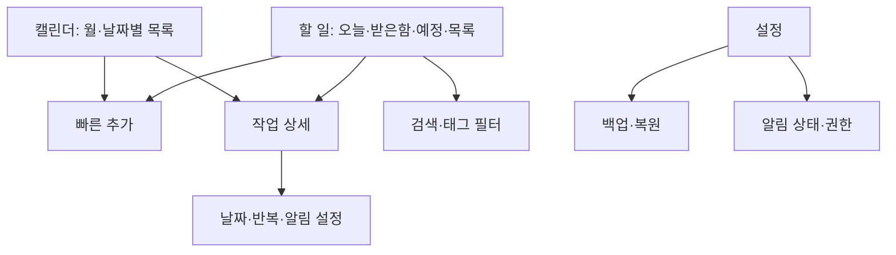

# 제품·화면 설계 v0.1

상태: 검토용 초안. 기준일: 2026-10-11.

## 1. 목표와 전제

사용자가 생각난 일을 바로 기록하고, 오늘 할 일을 정리하며, 날짜와 알림으로 실행하는 안드로이드 앱을 만든다.
사용자가 확정한 방향은 개인용·오프라인 우선이다. 나머지는 이 문서의 제안이며 구현 전에 조정할 수 있다.

- 네트워크와 계정 없이 핵심 기능 전체가 동작한다.
- 기본 언어는 한국어, 날짜·시간 표시는 기기 설정을 따른다.
- 첫 실행에서 할 일을 바로 만들 수 있다. 권한은 필요한 시점에 요청한다.
- 앱 이름은 미정이며 저장소 이름 `tool_ScheduleMng`를 작업명으로 사용한다.
- 기능을 참고하되 자체 화면과 자산을 사용한다. TickTick 연동·데이터 가져오기는 별도 요구사항이다.

## 2. 참고 기능과 단계

아래 목록은 공개 기능 소개를 바탕으로 분류한 범위다. TickTick 전체 동작이나 플랫폼별 제공 범위를 검증한 목록은 아니다.
M1은 첫 사용 가능한 버전, M2는 개인 생산성 확장, M3는 고급 보기, M4는 별도 서버·외부 연동 설계 단계다.

| 기능군 | 이 앱의 범위 | 단계 |
|---|---|---|
| 할 일 관리 | 제목·메모·날짜·시간·우선순위, 생성·수정·완료·삭제·복구 | M1 |
| 분류 | 목록, 태그, 체크리스트, 수동 순서 | M1 |
| 기본 보기 | 받은함, 오늘, 예정, 전체, 완료, 휴지통, 검색 | M1 |
| 반복·알림 | 일·주·월·년 간격 반복, 요일 선택, 종료일, 여러 알림, 미루기 | M1 |
| 캘린더 | 월 보기와 선택 날짜의 일정 목록 | M1 |
| 백업·설정 | JSON 내보내기·복원, 밝게/어둡게/시스템 테마 | M1 |
| 습관 | 목표 빈도, 체크인, 연속 기록, 달성률 | M2 |
| 집중 | 포모도로·스톱워치, 작업 연결, 세션 기록 | M2 |
| 위젯·통계 | 오늘 할 일·빠른 추가, 완료·습관·집중 통계 | M2 |
| 날짜 입력 | 한국어 자연어 날짜, 해석 결과 확인 후 적용 | M2 |
| 고급 캘린더 | 주·일 시간표, 일정 길이와 드래그 조정 | M3 |
| 고급 분류·보기 | 저장 필터, 칸반, 타임라인, 아이젠하워 매트릭스 | M3 |
| 중요 날짜 | 기념일·카운트다운 | M3 |
| 동기화·협업 | 로그인, 여러 기기, 공유 목록, 담당자 | M4 |
| 외부 서비스 | Google Calendar·캘린더 구독, 다른 앱 연동 | M4 |
| 확장 기능 | 지속 알림, 음성 입력·AI 요약, 자동화 API, 추가 테마 | M4에서 필요성 재검토 |

습관과 집중 기능은 계획에 포함하지만 M1 구현 범위에는 포함하지 않는다.
이메일 알림, 위치 알림, 데스크톱 전용 기능은 Android 개인용 초기 범위 밖이다.

## 3. 주요 사용 흐름

1. 빠른 기록: 어느 주요 화면에서든 추가 버튼 → 제목 입력 → 저장 → 받은함에 표시.
2. 오늘 계획: 오늘 화면 → 기한이 지난 일과 오늘 일을 확인 → 우선순위·시간 조정.
3. 반복 일정: 상세 화면 → 반복 주기와 알림 지정 → 이번 회차 완료 → 다음 회차 표시.
4. 일정 확인: 캘린더 → 날짜 선택 → 해당 날짜 작업 확인 → 상세에서 날짜 변경.
5. 데이터 보호: 설정 → 백업 저장 → 복원 파일 선택 → 항목 수 확인 → 교체 복원.

빠른 추가의 기본값은 받은함, 날짜 없음, 우선순위 없음이다.
캘린더에서 추가하면 선택 날짜를 미리 채우며, 저장 전에 변경할 수 있다.

## 4. 화면 구조

M1 하단 메뉴는 **할 일 / 캘린더 / 설정** 세 개다. M2에서 습관과 집중을 추가한다.
할 일 화면의 상단 보기 선택에서 받은함·오늘·예정·전체·완료·휴지통·사용자 목록으로 이동한다.
태그 필터와 검색은 할 일 화면에서 연다. 미구현 기능을 빈 탭으로 노출하지 않는다.



오늘 화면의 개념 배치:

```text
┌─────────────────────────┐
│ 오늘 ▾              검색 │
│ 날짜              목록 ▾ │
│ 기한 지난 일             │
│ □ 보고서 제출    어제     │
│ 오늘                     │
│ □ 회의 준비      14:00   │
│ □ 운동           높음    │
│                    ＋    │
│ 할 일   캘린더   설정     │
└─────────────────────────┘
```

| 화면 | 주요 조작·표시 |
|---|---|
| 할 일 | 완료 체크, 제목·시간·우선순위, 목록 변경, 정렬, 추가 |
| 빠른 추가 | 제목 필수, 날짜·목록 선택, 상세 편집으로 이동 |
| 상세 | 메모, 체크리스트, 태그, 기한, 우선순위, 반복, 알림, 삭제 |
| 캘린더 | 월 이동, 날짜 선택, 작업 표시 점, 날짜별 작업 목록 |
| 설정 | 테마, 백업·복원, 알림 권한 상태, 앱 정보 |
| 휴지통 | 복구, 영구 삭제 확인, 전체 비우기 확인 |

빈 목록에는 짧은 안내와 추가 버튼을 표시한다. 검색 결과 없음, 저장 오류, 복원 오류를 구별한다.
스와이프는 보조 조작이다. 완료·삭제 기능은 버튼이나 메뉴로도 접근할 수 있어야 한다.
터치 영역은 최소 48dp, 글자 확대와 TalkBack을 지원하고 우선순위를 색상만으로 표현하지 않는다.

## 5. 사용자에게 보이는 규칙

- 오늘: 미완료 작업 중 기한이 오늘인 작업과 기한이 지난 작업을 별도 구역으로 표시한다.
- 예정: 내일부터의 날짜 있는 미완료 작업을 날짜순으로 표시한다.
- 받은함: 받은함 목록의 미완료 작업. 날짜가 있어도 목록 소속은 유지한다.
- 전체: 휴지통을 제외한 모든 미완료 작업. 완료는 별도 보기에서 확인한다.
- 캘린더: 지정 기한 날짜에 표시한다. 날짜 없는 작업은 받은함·전체에서 확인한다.
- 검색: 제목과 메모를 대상으로 하며 기본은 미완료, 완료 포함은 선택 가능하다.
- 우선순위: 없음·낮음·중간·높음. 초기 정렬은 우선순위 높은 순, 같은 우선순위는 시간순, 이후 수동 순서다.
- 체크리스트 전체 체크가 부모 작업을 자동 완료하지 않는다. 완료는 사용자가 선택한다.
- 목록 삭제는 확인 후 소속 작업을 받은함으로 이동한다. 작업을 함께 삭제하지 않는다.
- 작업 삭제는 휴지통 이동이다. 자동 영구 삭제는 하지 않는다. 복구하면 알림을 다시 계산한다.
- 반복 완료·수정·되돌리기의 구체적인 규칙은 기술 설계 문서를 따른다.
- 알림이 꺼져도 작업 저장은 가능하다. 권한 상태와 알림 지연 가능성을 화면에서 알려준다.

## 6. M1 수용 기준

| 시나리오 | 통과 조건 |
|---|---|
| 오프라인 생성·수정 | 비행기 모드에서 저장·조회·완료 가능, 앱 재시작 후 내용 유지 |
| 빠른 추가 | 제목만 입력해 저장 가능, 공백 제목은 저장 차단 |
| 보기 정확성 | 오늘·지난 일·예정·날짜 없음·완료·휴지통이 정의대로 구분 |
| 반복 일정 | 월말·윤년·요일·종료일 테스트 통과, 완료 중복으로 회차 중복 생성 없음 |
| 알림 | 완료·삭제 후 취소, 수정·재부팅 후 재예약, 권한 거부 상태에서 앱 정상 동작 |
| 캘린더 | 월 전환·날짜 선택·작업 이동이 목록과 일치 |
| 복원 | 손상 파일은 기존 데이터 유지, 정상 파일은 확인 후 전체 교체, 관계·회차·알림 복구 |
| 접근성 | 큰 글씨에서 주요 조작 가능, TalkBack으로 생성·완료·삭제 가능 |

## 7. 참고 자료

- [TickTick 공식 홈페이지](https://ticktick.com/): 할 일·캘린더·집중·습관·카운트다운, 협업·동기화 등 기능군 확인.
- [TickTick 공식 기능 소개](https://ticktick.com/features): 목록·태그·필터·위젯·반복·알림 등 확인.

이 문서의 단계, 화면 구성, 데이터 규칙은 이 앱을 위한 제안이다. TickTick의 내부 설계를 추정하지 않는다.
