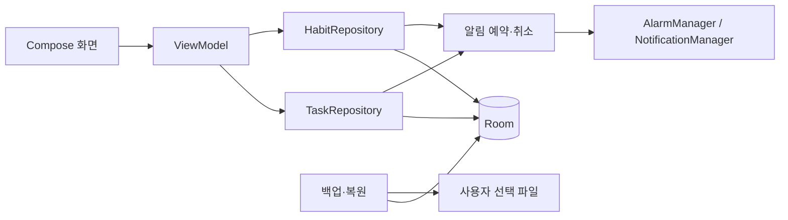
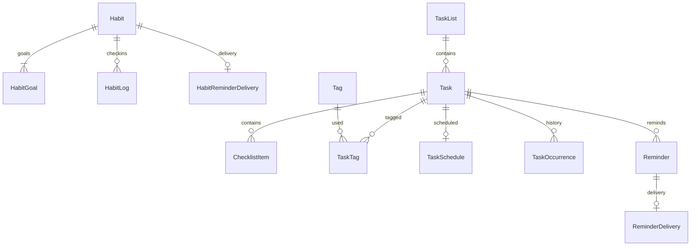

# 기술·데이터 설계 v0.2

상태: 제품 설계를 구현하기 위한 제안. 앱 코드와 의존성 버전은 아직 없다.

## 1. 기술 선택

| 항목 | 제안 | 이유 |
|---|---|---|
| 플랫폼 | Android 네이티브, Kotlin | 요청 플랫폼에 집중하고 알림·위젯을 직접 사용 |
| UI | Jetpack Compose, Material 3, Navigation Compose | 공식 UI 도구와 표준 컴포넌트 활용 |
| 상태 | ViewModel, Coroutines, Flow | 화면 상태와 비동기 DB 조회 연결 |
| 저장 | Room, 설정은 DataStore | 관계 데이터와 마이그레이션, 단순 설정 분리 |
| 알림 | AlarmManager, NotificationManager | 사용자가 정한 시각의 알림 |
| 파일 | Storage Access Framework | 사용자가 지정한 백업 파일 읽기·쓰기 |
| 직렬화 | kotlinx.serialization | 버전 있는 백업 JSON 검증 |
| 테스트 | JUnit, Room 기기 테스트, Compose UI 테스트 | 날짜 계산·관계·사용 흐름 검증 |

최소 지원 버전은 Android 8.0/API 26을 제안한다. 실제 사용자 기기 확인 후 확정한다.
compileSdk·targetSdk·라이브러리 버전은 구현 시작 시 공식 안정 버전과 배포 요구사항을 확인해 고정한다.
M1에는 서버, 로그인, 네트워크 의존 기능, 외부 분석 SDK를 넣지 않는다.

## 2. 구조와 변경 범위

단일 `app` 모듈로 시작한다. 화면은 ViewModel을 통해 저장소를 사용한다.
반복 날짜 계산과 백업 검증은 Android UI 없이 테스트할 수 있는 작은 함수로 분리한다.
모든 CRUD를 감싸는 별도 use-case 계층이나 멀티 모듈은 만들지 않는다.
객체 연결은 Application의 작은 컨테이너로 시작하고 DI 프레임워크는 필요할 때 검토한다.

예상 패키지는 `ui/habits`, `ui/tasks`, `ui/calendar`, `ui/settings`, `data`, `reminders`, `backup`이다.
현재 저장소에는 호출자·테스트·빌드 설정이 없다. 이번 변경은 README와 설계 문서만 다룬다.
구현 단계의 작업 변경은 DB, 목록·상세·캘린더, 반복 처리, 알림, 백업, 테스트 모두에 도달해야 한다.
습관 변경은 DB, 오늘 체크인·상세·목표 편집, 통계 계산, 알림, 백업, 테스트에 반영해야 한다.

## 3. M1 데이터 모델

PK는 UUID 문자열이다. 받은함은 삭제할 수 없는 고정 목록이다.
createdAt·updatedAt·completedAt·deletedAt 등 기록 시각은 UTC epoch milliseconds로 저장한다.
사용자가 정한 날짜는 ISO LocalDate, 시간은 LocalTime, 시간대는 IANA ZoneId로 보관한다.

| 엔터티 | 주요 필드·제약 |
|---|---|
| Habit | id, name(1~100자), note(최대 20,000자), startDate, zoneId, sortOrder, reminderTime?, archivedAt?, createdAt, updatedAt |
| HabitGoal | id, habitId FK, effectiveFrom, mode(DAILY/WEEKDAYS/WEEKLY_COUNT), weekdays?, targetDays?, unique(habitId, effectiveFrom) |
| HabitLog | id, habitId FK, date, checkedAt, unique(habitId, date) |
| HabitReminderDelivery | habitId FK/PK, date, triggerAt, deliveredAt? |
| TaskList | id, name(1~100자), color, sortOrder, isInbox |
| Task | id, listId FK, title(1~500자), note(최대 20,000자), priority(0~3), sortOrder, createdAt, updatedAt, completedAt?, deletedAt? |
| ChecklistItem | id, taskId FK, text(1~500자), isDone, sortOrder |
| Tag | id, name(1~50자), normalizedName unique, color |
| TaskTag | taskId FK + tagId FK 복합 PK |
| TaskSchedule | taskId PK/FK, dueDate, dueTime?, zoneId?, recurrenceUnit?, interval?, weekdays?, anchorDate, untilDate? |
| TaskOccurrence | id, taskId FK, scheduledDate, scheduledTime?, completedAt, unique(taskId, scheduledDate) |
| Reminder | id, taskId FK, minutesBefore(0 이상), unique(taskId, minutesBefore) |
| ReminderDelivery | reminderId FK/PK, occurrenceDate, triggerAt, snoozedUntil?, deliveredAt? |

TaskSchedule은 날짜 있는 작업만 가진다. dueTime이 없으면 종일 작업이며 zoneId는 null이다.
dueTime이 있으면 zoneId도 필수다. 시간만 있고 날짜 없는 일정은 M1에서 허용하지 않는다.
반복은 일·주·월·년 단위와 1 이상 간격만 허용한다. 요일 선택은 주 단위에서만 허용한다.
태그 중복 판단은 trim 및 Locale.ROOT 소문자화를 적용한다. 한 작업의 알림은 최대 5개다.
ReminderDelivery는 발송 상태와 미루기 상태를 저장한다. 알림 ID·회차·예약 시각이 바뀌면 새 예약으로 취급한다.

Task.listId, Task.completedAt, Task.deletedAt, TaskSchedule.dueDate, ChecklistItem.taskId를 인덱싱한다.
FK를 활성화하며 작업 영구 삭제는 연결 행을 cascade 삭제한다. 목록 삭제는 받은함 이동과 삭제를 한 트랜잭션으로 처리한다.
휴지통 이동은 Task.deletedAt만 설정하고 관계를 보존한다. 태그 삭제는 연결만 지우고 작업을 보존한다.
HabitLog.date와 HabitGoal.habitId를 인덱싱한다. 습관 영구 삭제는 목표·체크인·발송 상태를 cascade 삭제한다.

### 습관·체크인 저장 및 계산 규칙

- 습관은 작업과 별도 엔터티다. M1은 하루 한 번 완료 여부만 기록한다. 미완료 행은 만들지 않는다.
- HabitLog.date는 습관 생성 시 저장한 zoneId의 LocalDate다. 여행 중에도 기록 날짜를 재배치하지 않는다.
- 습관의 시간대는 M1에서 변경하지 않는다. 상세에 시간대를 표시하고 오늘 화면의 날짜도 이를 기준으로 표시한다.
- DAILY는 모든 날짜, WEEKDAYS는 선택한 1~7개 요일, WEEKLY_COUNT는 월~일 중 targetDays(1~7)일이다.
- 목표 필드는 mode별로 검증한다. 사용하지 않는 weekdays 또는 targetDays는 null이어야 한다.
- HabitGoal은 시작일부터 유효한 첫 목표를 가진다. 특정 날짜에는 effectiveFrom이 그 날짜 이하인 최신 목표를 사용한다.
- 목표 편집은 해당 습관 시간대의 내일부터 적용한다. 같은 적용일의 재편집은 기존 예약 목표를 교체한다.
- 시작일과 과거 목표는 변경하지 않는다. 주 N일 목표를 포함하는 mode·targetDays 변경은 다음 월요일부터 적용해 한 주의 기준을 보존한다.
- 체크인은 날짜 검증 후 insert-if-absent로 저장한다. 중복 탭·재시도·알림 액션은 한 기록만 만든다.
- 취소는 해당 habitId/date를 삭제하며 재시도해도 결과가 같다. 상태 반전 요청 대신 명시적 체크인·취소를 사용한다.
- 과거 수정은 startDate부터 오늘까지 허용하되 당시 요일 목표를 검증한다. 미래 기록과 비대상 날짜는 거부한다.
- 주 N일 목표를 초과한 날짜도 체크인할 수 있지만 달성률은 100%를 넘지 않는다.
- DAILY/WEEKDAYS 연속 달성은 연속된 대상 날짜만 센다. 비대상 날짜는 건너뛰고 아직 끝나지 않은 오늘은 미달성으로 끊지 않는다.
- WEEKLY_COUNT 연속 달성은 주 단위다. 목표를 채운 현재 주는 포함하되 진행 중인 미달성 주는 연속 기록을 끊지 않는다.
- 시작일이 주 중간이면 첫 주 목표는 targetDays와 시작일부터 일요일까지 남은 날짜 수 중 작은 값이다.
- 기간 달성률: 일·요일 목표는 체크인한 대상 날짜/대상 날짜 수, 주 목표는 각 주의 min(체크인 일수, 목표 일수) 합/주별 목표 합이다.
- 통계 분모는 시작일부터 어제까지의 일 목표 또는 종료된 주 목표만 사용한다. 진행 중인 오늘·주는 별도 진행률로 표시한다.
- 선택 기간 경계의 일부 주는 주간 달성률에서 제외한다. 시작일로 잘린 첫 주는 위 보정 목표를 사용한다. 분모가 0이면 ‘집계할 기록 없음’이다.
- 목표 mode가 바뀐 전후 구간의 일 단위·주 단위 연속 달성은 별도 표시한다. 단위가 다른 기록을 하나의 숫자로 합치지 않는다.
- 과거 체크인 수정 시 통계를 원본 목표·로그에서 재계산한다. M1은 별도 통계 캐시를 저장하지 않는다.
- 보관된 습관은 기록 조회·백업만 가능하다. M1은 보관 해제를 제공하지 않으며 이후 체크인·알림·통계 대상 날짜 생성을 중단한다.

예: 월·수·금 독서는 월·수 완료 시 2회 연속이다. 화요일은 끊김이 아니다.
주 3일 운동은 같은 날 중복 체크인해도 1일이며 월·수·금 체크인 시 3/3일이다.

## 4. 날짜·반복 규칙

- 종일 일정의 날짜는 기기 시간대 변경으로 이동하지 않는다.
- 시간 일정은 저장한 시간대 기준이다. 여행 중에는 기기 현지 시각을 표시하고 원래 시간대도 상세에서 확인한다.
- 오늘 분류는 시간 일정의 기기 현지 날짜, 종일 일정의 저장 날짜로 판단한다.
- 서머타임에 존재하지 않는 시각은 다음 유효 시각으로 이동한다. 중복 시각은 먼저 발생하는 오프셋을 선택한다.
- 종일 작업의 알림 기준은 해당 날짜 기기 현지 09:00이다. 알림 설정 화면에 이를 표시한다.
- 반복은 예정일 기준이다. 완료한 시각으로 반복 간격을 옮기지 않는다.
- 완료 시 현재 회차 이력을 저장하고, 다음 날짜를 계산해 TaskSchedule을 갱신한다. 한 트랜잭션으로 실행한다.
- 기한 지난 반복을 늦게 완료하면 완료일 이후 첫 회차로 이동한다. 건너뛴 회차를 완료로 집계하지 않는다.
- 월 반복의 31일은 짧은 달의 말일로 보정하되 anchorDate의 31일은 보존한다. 이후 31일로 복귀한다.
- 2월 29일의 연 반복은 평년 2월 28일, 윤년 2월 29일로 계산한다.
- 주 반복은 anchorDate가 속한 월요일 시작 주를 기준으로 interval과 선택 요일을 계산한다.
- untilDate는 포함이다. 다음 회차가 종료일을 넘으면 부모 작업을 완료 상태로 바꾼다.
- 반복 작업의 체크리스트는 새 회차에서 초기화한다. 제목·메모·태그는 유지한다.
- 완료 요청은 taskId와 현재 예정일을 비교한다. 이미 처리한 회차 요청은 무시한다.
- 직후 실행 취소는 회차 이력·일정·체크리스트를 트랜잭션으로 복구한다. 이후 추가 변경이 있으면 되돌리기를 차단한다.
- M1 반복 수정은 현재 및 이후 회차에 적용하며 과거 이력을 바꾸지 않는다. 개별 미래 회차 예외는 M3 후보이다.
- 반복 작업의 완료 보기는 TaskOccurrence 이력을 보여준다. 일반 작업은 Task.completedAt으로 보여준다.

예: 매월 31일 작업은 1/31 → 2/28 → 3/31. 매일 작업을 10/10에서 10/13에 완료하면 다음은 10/14다.
캘린더는 조회 월에 해당하는 반복 예정 회차를 계산해 표시한다. 미래 회차를 미리 DB 행으로 생성하지 않는다.
미래 회차를 선택하면 부모 작업 상세를 열고 선택 날짜를 표시한다. 현재 회차만 완료할 수 있다.

## 5. 알림 신뢰성

DB가 원본이다. 작업을 저장한 뒤 알림을 예약·취소한다. OS 예약 실패로 작업 저장을 취소하지 않는다.
앱 시작·기기 재부팅·시간 및 시간대 변경·정확한 알람 권한 부여 후 DB에서 예약을 복구한다.
반복 작업은 현재 활성 회차의 알림만 예약한다. 완료·삭제·날짜 변경 시 기존 예약과 게시 알림을 취소한다.
습관은 저장된 시간대의 다음 대상 날짜 알림을 예약한다. 발송 후 다음 대상 날짜를 예약하며 주 목표·보관 여부를 다시 검사한다.
체크인·취소·목표 변경·보관 시 알림을 재계산한다. 체크인한 날짜와 주 목표 달성 후의 날짜는 발송하지 않는다.
습관 알림 액션은 habitId/date를 명시한 체크인이다. 지난 날짜 액션을 오늘 기록으로 바꾸지 않는다.
발송 상태는 HabitReminderDelivery에 저장하고 재부팅·권한 변경 후 재예약 시 중복 발송을 차단한다.

- Android 13 이상에서 알림 권한은 첫 알림 설정 시 맥락과 함께 요청한다.
- 정확한 알람은 지원 API에서 권한 상태를 확인한다. 필요 시 설정 화면을 안내하며 무조건 권한을 요구하지 않는다.
- 정확한 예약이 불가능하면 부정확한 알람으로 대체하고 지연 가능성을 알린다.
- WorkManager는 정확한 시각 알림용으로 쓰지 않는다. M4 동기화 등 지연 가능한 작업에 검토한다.
- PendingIntent는 알림 UUID별 고유 식별자를 사용하고 immutable로 생성한다.
- 수신 시 DB의 작업·회차·예약 시각·발송 상태를 재검사한다. 수정 전 예약이나 중복 발송은 무시한다.
- 알림 액션은 완료와 10분 미루기를 제공한다. 오래된 회차 액션으로 다음 회차가 완료되지 않게 검증한다.
- 이미 지난 알림을 한꺼번에 발송하지 않는다. 복구 시 미발송 알림은 다음 앱 실행에서 누락 상태로 표시한다.
- 강제 종료, 권한 철회, 제조사 절전 정책으로 알림이 제한될 수 있다. 실제 기기 검증을 출시 조건으로 둔다.

잠금 화면 알림의 상세 내용은 기본 숨김으로 설정한다. 캘린더·연락처·마이크 권한은 M1에서 요청하지 않는다.

## 6. 백업·복원과 데이터 보호

백업은 `schemaVersion`, `exportedAt`, 습관·목표 이력·날짜별 체크인·습관 알림 설정, 목록·작업·체크리스트·태그·일정·회차·알림·설정의 JSON이다.
발송 캐시는 내보내지 않는다. 복원 후 알림을 다시 계산하고 지난 알림은 발송하지 않는다.

1. 내보내기는 일관된 DB 스냅샷을 읽는다. 파일 저장 실패는 기존 DB에 영향을 주지 않는다.
2. 복원은 선택 파일을 임시로 파싱한다. 최대 20MiB, 항목 합계 최대 100,000개로 제한한다.
3. 지원 버전, 필수 필드, 길이·열거값·날짜·시간대, 중복 ID, FK, 받은함 존재를 검증한다.
   습관별 시작 목표, 목표 mode별 필드, 날짜별 체크인 중복·유효 범위도 검증한다.
4. 현재 항목 수와 복원 항목 수를 보여주고 **현재 데이터 전체 교체**를 명시해 확인받는다.
5. 교체 전 현재 데이터의 복구 스냅샷을 앱 내부 파일에 저장한다. 저장 실패하면 복원을 중단한다.
6. 한 DB 트랜잭션으로 교체하고 검증 실패 시 rollback한다. 성공 후 OS 알림을 전체 재계산한다.
7. UI·알림 액션과 복원이 동시에 데이터를 변경하지 않도록 저장소에서 직렬화한다.

알 수 없는 상위 schemaVersion은 거부한다. M1은 병합 복원을 제공하지 않는다.
백업 파일은 평문이며 사용자가 선택한 저장 위치로 나갈 수 있음을 내보내기 화면에 표시한다.
앱 DB는 내부 저장소에 둔다. M1은 시스템 자동 백업·기기 전송에서 DB를 제외하고 명시적 파일 백업을 제공한다.
복원 스냅샷은 앱 내부에 최근 한 개만 유지한다. 앱 삭제 시 내부 데이터와 스냅샷은 함께 삭제된다.
DB 업그레이드는 명시적 Room migration으로 처리하고 destructive migration은 사용하지 않는다.
개인 메모·백업 내용은 로그에 출력하지 않는다. 서명 키·토큰·사용자 백업은 Git에 올리지 않는다.

## 7. 후속 확장 경계

Habit/HabitGoal/HabitLog는 M1 필수다. M2에서 FocusSession을 별도 테이블로 추가한다.
집중 타이머는 종료 시각과 실행 상태를 저장해 앱 재시작 시 복구하며 백그라운드 정책을 별도 검토한다.
위젯은 Room 데이터를 읽고 기존 완료·추가 로직을 호출한다.

M4 동기화는 UUID를 유지하되 서버·인증·변경 큐·삭제 전파·충돌 정책·접근 제어를 별도로 설계한다.
updatedAt만으로 충돌을 해결한다고 가정하지 않는다. 오프라인 앱 코드가 곧 동기화 구현이라고 보지 않는다.

## 8. 기술 근거

- [Compose 공식 문서](https://developer.android.com/compose): Android 권장 네이티브 UI 도구.
- [Room 공식 문서](https://developer.android.com/training/data-storage/room): SQLite 관계 데이터, 쿼리 검증과 migration 지원.
- [알람 공식 문서](https://developer.android.com/develop/background-work/services/alarms): 정확한 알람 권한·재예약 규칙.
- [알림 권한 공식 문서](https://developer.android.com/develop/ui/views/notifications/notification-permission): Android 13 이상 런타임 권한.
- [WorkManager 공식 문서](https://developer.android.com/develop/background-work/background-tasks/persistent-work/getting-started): 지속적인 백그라운드 작업.

구체적인 데이터 구조·기본값·기능 단계는 이 프로젝트의 설계 결정이다.
