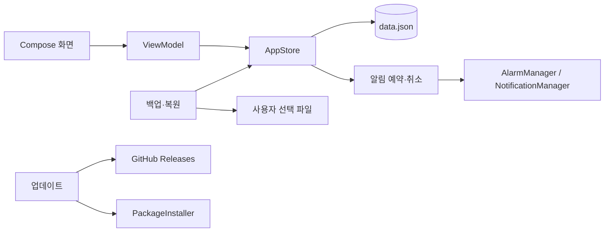

# 하루결 기술·데이터 설계 v0.5

상태: 제품 설계를 구현하기 위한 제안. 앱 코드와 의존성 버전은 아직 없다.
사용자에게 보이는 동작은 [제품 설계](product-design.md)를 따른다. 이 문서는 저장·계산·OS 연동만 다룬다.

## 1. 기술 선택

| 항목 | 제안 | 이유 |
|---|---|---|
| 플랫폼 | Android 네이티브, Kotlin | 요청 플랫폼에 집중하고 알림·설치 API를 직접 사용 |
| UI | Jetpack Compose, Material 3, Navigation Compose | 공식 UI 도구와 표준 컴포넌트 활용 |
| 상태 | ViewModel, Coroutines, Flow | 화면 상태와 저장소 연결 |
| 저장 | 앱 내부 JSON 파일 하나, 임시 파일 쓰기·동기화 후 원자적 이동(`java.nio`) | DB 없이 단순 구조, 백업 파일과 같은 형식 |
| 직렬화 | kotlinx.serialization | 저장·백업·복원이 같은 코드 사용 |
| 알림 | AlarmManager(`USE_EXACT_ALARM`), NotificationManager | 사용자가 정한 시각의 알림 |
| 파일 | Storage Access Framework | 사용자가 지정한 백업 파일 읽기·쓰기 |
| 업데이트 | GitHub Releases API, `HttpURLConnection`, PackageInstaller | 추가 의존성 없음 |
| 글자체·그림 | Jua, Pretendard를 앱에 포함(res/font), 벡터 드로어블(VectorDrawable) | 오프라인 동일 표시, 해상도 무관 |
| 테스트 | JUnit, Compose UI 테스트 | 날짜 계산·파일 검증·사용 흐름 검증 |

최소 지원 버전은 Android 13/API 33이다. 알림 권한과 `USE_EXACT_ALARM`이 항상 있어 버전 분기가 사라진다.
우선 검증 기기 갤럭시 S26 울트라(SM-S948N)는 Android 17(API 37), One UI 9.0이다(2026-10-12 adb로 확인). 절전 설정은 기기 검증 때 확인한다. compileSdk·targetSdk는 37이다(Compose 1.12가 compileSdk 37을 요구한다). AGP 9.4.1, Kotlin 2.4.21, Compose BOM 2026.09.00, Gradle 9.8.1로 빌드를 확인했다.
compileSdk·targetSdk·라이브러리 버전은 구현 시작 시 공식 안정 버전을 확인해 고정한다.
M1에는 서버, 로그인, 외부 분석 SDK를 넣지 않는다. 네트워크는 업데이트 확인·다운로드에만 쓴다.

## 2. 구조

단일 `app` 모듈이다. 화면은 ViewModel을 통해 저장소 `AppStore` 하나를 사용한다.

- `AppStore`는 앱 시작 시 저장 파일을 읽어 메모리 상태(`StateFlow<AppData>`)로 들고 있다.
- 모든 변경은 하나의 Mutex 안에서 새 상태 계산 → 파일 원자적 쓰기 → 성공 시 상태 공개 순서로 처리한다. 쓰기에 실패하면 이전 상태를 유지하고 오류를 표시한다.
- 화면, 알림 수신기, 타이머 저장, 복원, 업데이트 전 스냅샷이 모두 같은 경로를 쓴다. 다중 프로세스는 쓰지 않는다.
- 반복 날짜·습관 목표·통계 계산과 파일 검증은 Android 없이 테스트할 수 있는 순수 함수로 둔다.
- use-case 계층, 멀티 모듈, DI 프레임워크는 만들지 않는다. 객체 연결은 Application의 작은 컨테이너로 한다.



예상 패키지는 `ui/habits`, `ui/tasks`, `ui/calendar`, `ui/settings`, `data`, `reminders`, `backup`, `update`이다.

## 3. 저장 파일

### 3.1 파일과 쓰기

- 위치는 `filesDir/data.json`이다. 설정을 포함한 앱 데이터 전체가 이 파일 하나다.
- 쓰기는 임시 파일(`data.json.tmp`)에 쓰고 `fsync`한 뒤 `Files.move(ATOMIC_MOVE)`로 교체한다. JVM 단위 테스트에서 검증할 수 있도록 `AtomicFile` 대신 `java.nio`를 쓴다. 쓰는 도중 앱이 종료돼도 직전 파일 또는 새 파일이 온전히 남는다.
- 변경마다 전체 파일을 다시 쓴다. 습관 20개를 10년 기록해도 약 3MB 수준이라 개인 사용에 충분하다.
  쓰기 지연이 체감되면 연도별 기록 파일 분리를 검토한다.
- 시작 시 파일을 읽을 수 없으면 자동으로 덮어쓰지 않는다. 복구 화면에서 내부 스냅샷이나 백업 파일 복원을 안내한다.
- 파일에는 `schemaVersion` 정수를 둔다. 낮은 버전은 코드의 변환 함수로 차례대로 올린 뒤 저장한다. 앱보다 높은 버전은 파일을 건드리지 않고 거부한다.
- 개인 메모·기록 내용은 로그에 출력하지 않는다.

### 3.2 문서 구조

소유 관계는 중첩으로 표현해 별도 참조를 줄인다.

```json
{
  "schemaVersion": 1,
  "settings": { "theme": "SYSTEM", "dailySummary": { "enabled": true, "time": "20:30" },
                "allDayReminderTime": "09:00", "celebrationHaptics": true, "lastCelebrationDate": null },
  "habits": [ { "id": "…", "name": "물 마시기", "measureType": "QUANTITY", "unit": "잔",
                "startDate": "2026-10-12", "sortOrder": 0, "archivedAt": null,
                "goals": [ { "effectiveFrom": "2026-10-12", "mode": "DAILY", "targetAmount": 800 } ],
                "logs": [ { "date": "2026-10-12", "amount": 300, "skipped": false } ],
                "reminders": [ "09:00", "15:00" ] } ],
  "timer": null,
  "lists": [ { "id": "…", "name": "받은함", "color": null, "isInbox": true } ],
  "tags": [],
  "tasks": []
}
```

ID는 UUID 문자열이다. 기록 시각(createdAt·updatedAt·completedAt·deletedAt·archivedAt)은 UTC epoch milliseconds다.
사용자가 정한 날짜는 ISO LocalDate, 시각은 `HH:mm` 문자열이다. 시간대는 저장하지 않는다.

| 객체 | 필드·제약 |
|---|---|
| settings | theme(SYSTEM/LIGHT/DARK), dailySummary{enabled, time}, allDayReminderTime(`HH:mm`, 기본 09:00), celebrationHaptics, lastCelebrationDate?(전부 달성 효과를 마지막으로 보인 날짜) |
| habits[] | id, name(1~100자), colorIndex(0~3), iconKey?, note(최대 20,000자), measureType(CHECK/QUANTITY/DURATION), unit?, startDate, sortOrder, archivedAt?, createdAt, updatedAt, goals[], logs[], reminders[] |
| habits[].goals[] | effectiveFrom(습관 안에서 고유), mode(DAILY/WEEKDAYS/WEEKLY_COUNT), weekdays?, targetDays?, targetAmount |
| habits[].logs[] | date(습관 안에서 고유), amount, skipped |
| habits[].reminders[] | `HH:mm`, 습관 안에서 고유, 최대 5개 |
| timer? | sessionId, habitId, date, state(RUNNING/PAUSED), accumulatedMs, segmentStartedElapsedMs?, bootCount?, checkpointMs, updatedAt |
| lists[] | id, name(1~100자), color?, isInbox(정확히 1개) |
| tags[] | id, name(1~50자), color?, trim·Locale.ROOT 소문자화한 이름이 고유 |
| tasks[] | id, listId, title(1~500자), note(최대 20,000자), priority(0~3), tagIds[], checklist[], schedule?, reminders[], occurrences[], createdAt, updatedAt, completedAt?, deletedAt? |
| tasks[].checklist[] | id, text(1~500자), isDone. 배열 순서가 표시 순서 |
| tasks[].schedule? | dueDate, dueTime?, recurrence?{unit(DAY/WEEK/MONTH/YEAR), interval(1 이상), weekdays?, anchorDate, untilDate?} |
| tasks[].reminders[] | minutesBefore(0 이상, 작업 안에서 고유, 최대 5개), snoozedUntil? |
| tasks[].occurrences[] | scheduledDate(고유), scheduledTime?, completedAt |

### 3.3 검증과 일관성

시작 시 읽기와 복원은 같은 검증 함수를 쓴다.

- 필수 필드, 길이, 열거값, 날짜·시각 형식, 숫자 범위, 중복 ID, 위 표의 고유 조건.
- 참조는 세 가지뿐이다: `tasks[].listId`→lists, `tasks[].tagIds`→tags, `timer.habitId`→habits. 나머지는 중첩 구조라 참조가 없다.
- 받은함은 정확히 하나이며 삭제할 수 없다.
- schedule이 있으면 dueDate는 필수다. 시간만 있는 일정은 없다. weekdays는 WEEK 반복에서만 허용한다.
- 습관 검증은 3.4의 유형·목표·기록 규칙을 따른다.

변경은 한 번의 상태 교체로 처리해 중간 상태가 저장되지 않게 한다.

- 목록 삭제: 소속 작업(휴지통 포함)의 listId를 받은함으로 바꾸고 목록을 제거한다.
- 태그 삭제: 모든 작업의 tagIds에서 제거한다.
- 작업 휴지통 이동은 deletedAt만 설정한다. 영구 삭제는 작업 객체를 제거하며 중첩 항목도 함께 사라진다.
- 습관 영구 삭제는 습관 객체를 제거한다. 실행 중 타이머가 그 습관이면 먼저 저장 또는 버리기를 받는다.

### 3.4 습관 저장·계산 규칙

**유형과 값**

- 날짜별 기록 하나(logs[])에 합계를 저장하며 부분 기록도 유지한다. 개별 추가 이력은 저장하지 않는다.
- CHECK는 amount 0 또는 1, targetAmount 1이다. QUANTITY는 소수 둘째 자리 단위의 정수로 저장한다(1잔=100). DURATION은 정수 초다(30분 목표=1,800).
- QUANTITY의 unit은 1~20자 필수, DURATION은 ‘분’으로 고정하고 CHECK의 unit은 null이다. measureType·단위는 생성 후 불변이다.
- amount는 0~1,000,000,000, targetAmount는 1~1,000,000,000 범위다. 입력·합산·복원에서 범위와 유형을 검증한다.
- 수량 파싱은 기기 소수점 형식을 따르고 정확한 정수 변환을 사용한다. 소수 3자리 이상·NaN·무한대·음수·범위 초과는 거부한다.
- 달성 여부는 amount >= 당시 목표의 targetAmount로 계산한다. 완료 플래그는 저장하지 않는다. 초과량은 보존하고 UI 진행률만 100%로 제한한다.
- 시간 목표·수동 입력은 분을 초로 변환한다. 타이머는 초를 보존하며 부분 기록을 분으로 조기 반올림하지 않는다.

**날짜**

- 기록 날짜는 기록하는 순간 기기 시간대의 LocalDate다. 시간대가 바뀌어도 저장된 날짜는 옮기지 않는다.
- 시작일은 오늘 이하이며 생성 후 불변이다.

**목표**

- DAILY는 모든 날짜, WEEKDAYS는 선택한 1~7개 요일, WEEKLY_COUNT는 월~일 중 targetDays(1~7)일이다.
- 목표 필드는 mode별로 검증한다. 사용하지 않는 weekdays 또는 targetDays는 null이어야 한다.
- 첫 목표의 effectiveFrom은 startDate다. 특정 날짜에는 effectiveFrom이 그 날짜 이하인 최신 목표를 쓴다.
- 기록(amount > 0 또는 skipped)이 하나도 없으면 목표 편집은 첫 목표를 그대로 교체한다.
- 그 외에는 내일부터 적용한다. 변경 전후에 WEEKLY_COUNT가 포함되면 다음 월요일부터 적용한다.
- effectiveFrom이 오늘보다 뒤인 목표가 ‘예약된 변경’이다. 새 편집은 기존 예약을 지우고 하나만 저장한다. 취소는 예약 목표 삭제다.
- 과거 목표와 시작일은 바꾸지 않는다.

**기록 연산**

모든 쓰기는 `AppStore`의 Mutex로 직렬화한다. 화면·알림 액션·타이머 저장이 같은 연산을 쓴다. revision은 두지 않는다.

| 연산 | 동작 |
|---|---|
| setCheck(habitId, date, done) | amount = 1 또는 0. 여러 번 실행해도 결과가 같다 |
| addQuantity(habitId, date, delta) | amount += delta(＋1은 100). 누른 횟수만큼 반영, 범위 초과는 거부 |
| setTotal(habitId, date, amount) | 직접 입력·시간 기록·초기화 |
| setSkipped(habitId, date, skipped) | amount가 0일 때만 true 가능 |

- amount가 0보다 커지는 연산은 skipped를 false로 바꾼다.
- amount 0이고 건너뛰지 않은 기록은 logs에서 지운다.
- 알림의 체크인 액션은 날짜를 명시한 setCheck라 중복·지연 탭에도 안전하다.
- 과거 수정은 startDate부터 오늘까지 허용하되 당시 목표의 대상 날짜인지 검증한다. 미래와 비대상 날짜는 거부한다.

**통계**

- 주 N일 목표를 초과한 날짜도 기록할 수 있다. 목표량을 채운 날만 달성 일수로 센다.
- 주 목표 = min(targetDays, 그 주에서 시작일 이후이고 건너뛰지 않은 날짜 수). 시작일로 잘린 첫 주와 건너뛰기를 같은 식으로 처리한다. 결과가 0인 주는 집계하지 않는다.
- DAILY/WEEKDAYS 연속 달성은 연속된 대상 날짜만 센다. 비대상 날짜와 건너뛴 날은 건너뛰고 아직 끝나지 않은 오늘은 끊지 않는다.
- WEEKLY_COUNT 연속 달성은 주 단위다. 목표를 채운 현재 주는 포함하되 진행 중인 미달성 주는 끊지 않는다.
- 기간 달성률: 일·요일 목표는 달성한 대상 날짜/대상 날짜 수(건너뛴 날 제외), 주 목표는 각 주 min(달성 일수, 주 목표) 합/주 목표 합이다.
- 분모는 시작일부터 어제까지의 일 목표 또는 종료된 주만 쓴다. 진행 중인 오늘·주는 별도 진행률로 표시한다.
- 기간은 상세 달력에 표시 중인 달과 전체다. 달 경계에 걸친 주는 그 달의 주간 달성률에서 제외한다. 분모가 0이면 ‘집계할 기록 없음’이다.
- 목표 mode가 바뀐 전후 구간의 일 단위·주 단위 연속 달성은 따로 계산한다. 단위가 다른 기록을 하나의 숫자로 합치지 않는다.
- 통계는 매번 원본 목표·기록에서 계산한다. 별도 캐시는 저장하지 않는다.

**보관**

- archivedAt 이후 날짜는 기록·알림·통계 대상을 만들지 않는다. 보관 전 기록은 조회·수정·백업할 수 있다.
- 보관 해제는 archivedAt을 null로 되돌린다. 보관 기간의 대상 날짜는 미기록으로 계산한다.

**스티커**

- 스티커 상태는 저장하지 않는다. 날짜별 스티커는 달성한 날(amount >= 당시 목표)에서, 마일스톤은 연속 달성 최대값이 3·7·30·100 이상인지로 매번 계산한다.
- colorIndex는 빨강·파랑·노랑·초록 순서 0~3이며 범위를 벗어나면 복원을 거부한다. iconKey는 앱에 포함한 그림 목록의 키이고 없는 키는 기본 그림으로 표시한다.
- 글자체·그림은 앱 자원이라 업데이트로 바뀌어도 저장 파일에 영향이 없다.

예: 월·수·금 독서는 월·수 완료 시 2회 연속이다. 화요일은 끊김이 아니다. 수요일을 건너뛰고 월·금 완료해도 2회 연속이다.
주 3일 운동은 같은 날 중복 체크인해도 1일이며 월·수·금 체크인 시 3/3일이다. 토요일 시작이면 첫 주 목표는 2일이다.
물 8잔 목표에 3잔 기록은 amount=300, targetAmount=800이다. 8잔에 달성하며 9잔은 실제 기록 900을 유지한다.

### 3.5 습관 타이머

- `timer` 필드 하나에 세션 하나만 둔다. 오늘 기록할 수 있는 습관(대상 날짜·보관 안 됨)만 시작할 수 있다.
- 시작 날짜는 시작 시점의 오늘이며 자정 후에도 그 날짜에 기록한다.
- 경과 측정은 `SystemClock.elapsedRealtime()`의 차이로 계산한다. 벽시계 변경이나 화면 꺼짐으로 시간이 줄지 않는다.
- 시작·일시정지·재개와 화면을 떠날 때 저장한다. 화면이 열려 있으면 30초마다 checkpointMs를 저장한다.
- 부팅 판별은 `Settings.Global.BOOT_COUNT`다. 저장한 값과 같으면 segmentStartedElapsedMs로 복구한다. 다르면 checkpointMs 기준으로 일시정지하고 손실 가능 구간을 표시한다.
- 저장 요청은 sessionId를 담는다. 현재 timer의 sessionId와 같을 때만 amount += floor(총 경과 ms/1,000), skipped=false, timer=null을 한 번의 상태 교체로 처리한다. 다르거나 timer가 없으면 무시한다.
- 1초 미만·범위 초과는 저장하지 않고 안내한다. 버리기는 확인 후 timer=null이며 기록은 바꾸지 않는다.
- 백업 내보내기는 RUNNING 세션을 현재 측정량의 PAUSED 스냅샷으로 담는다. 복원 시 자동 재개하지 않는다.
- 앱 업데이트로 프로세스가 재시작돼도 같은 부팅이면 그대로 복구된다.

## 4. 날짜·반복 규칙

- 모든 날짜·시각은 기기의 현재 시간대 기준이다. 작업·습관에 시간대를 저장하지 않는다.
- 작업의 dueTime은 현지 벽시계 시각이다. 기기 시간대가 바뀌면 같은 현지 시각으로 알림을 다시 예약한다.
- 현지 시각을 절대 시각으로 바꾸는 계산은 java.time `ZonedDateTime`에 맡긴다. 한국은 서머타임이 없어 별도 규칙을 두지 않는다.
- 종일 작업의 알림 시각은 settings.allDayReminderTime(기본 09:00)이다. 작업 상세에 이 시각을 표시하고 설정에서 바꾸면 모든 종일 작업 알림을 다시 예약한다.
- 반복은 예정일 기준이다. 완료한 시각으로 반복 간격을 옮기지 않는다.
- 완료 시 현재 회차를 occurrences에 추가하고 다음 날짜로 schedule.dueDate를 갱신한다. 한 번의 상태 교체다.
- 기한 지난 반복을 늦게 완료하면 완료일 이후 첫 회차로 이동한다. 건너뛴 회차를 완료로 집계하지 않는다.
- 월 반복의 31일은 짧은 달의 말일로 보정하되 anchorDate의 31일은 보존한다. 이후 31일로 복귀한다.
- 2월 29일의 연 반복은 평년 2월 28일, 윤년 2월 29일로 계산한다.
- 주 반복은 anchorDate가 속한 월요일 시작 주를 기준으로 interval과 선택 요일을 계산한다.
- untilDate는 포함이다. 다음 회차가 종료일을 넘으면 작업의 completedAt을 설정한다.
- 반복 작업의 체크리스트는 새 회차에서 초기화한다. 제목·메모·태그는 유지한다.
- 완료 요청은 taskId와 현재 예정일을 함께 보낸다. 현재 dueDate와 다르면 이미 처리한 회차로 보고 무시한다.
- 직후 실행 취소는 직전 상태(회차·일정·체크리스트)로 되돌린다. 그 사이 다른 변경이 있으면 되돌리기를 막는다.
- 반복 수정은 현재 및 이후 회차에 적용하며 과거 이력을 바꾸지 않는다. 개별 미래 회차 예외는 M3 후보이다.
- 반복 작업의 완료 보기는 occurrences를 보여준다. 일반 작업은 completedAt으로 보여준다.

예: 매월 31일 작업은 1/31 → 2/28 → 3/31. 매일 작업을 10/10에서 10/13에 완료하면 다음은 10/14다.
캘린더는 조회 월에 해당하는 반복 예정 회차를 계산해 표시한다. 미래 회차를 미리 저장하지 않는다.
미래 회차를 선택하면 작업 상세를 열고 선택 날짜를 표시한다. 현재 회차만 완료할 수 있다.

## 5. 알림

저장 파일이 원본이다. 저장한 뒤 알림을 예약·취소한다. OS 예약 실패로 저장을 취소하지 않는다.

**예약**

- 앱 시작, `BOOT_COMPLETED`, `TIME_SET`, `TIMEZONE_CHANGED`, `MY_PACKAGE_REPLACED`(업데이트 후)에 전체를 다시 예약한다.
- 알림마다 ‘지금 이후 다음 발송 시각’ 하나만 예약한다. 지난 시각은 예약하지 않으므로 재부팅·재예약으로 이미 울린 알림이 다시 울리지 않는다. 발송 기록은 저장하지 않는다.
- 시계를 뒤로 돌리면 같은 날 다시 울릴 수 있다. 이는 허용한다.
- `setExactAndAllowWhileIdle`을 쓴다. `USE_EXACT_ALARM`은 설치 시 허용되어 사용자에게 요청하지 않는다. APK 직접 설치라 Play 정책 대상이 아니며 Play 출시 때 재검토한다.
- PendingIntent는 알림마다 고유 data URI로 구분한다(예: `haru://habit/{id}/0830`, `haru://task/{id}/15`, `haru://summary`). `FLAG_IMMUTABLE`로 만든다.

**수신 시 재검사**

- 그 알림이 아직 있는지, 인텐트에 담긴 예정 시각이 지금 다시 계산한 시각과 같은지 확인한다.
- 습관은 대상 날짜이고 보관·건너뜀이 아니며 그날·그 주 목표를 아직 채우지 않았을 때만 표시한다.
- 작업은 미완료·휴지통 아님이고 인텐트의 회차가 현재 dueDate와 같을 때만 표시한다.
- 조건이 하나라도 어긋나면 표시하지 않는다. 어느 경우든 다음 시각을 예약한다.
- 기록·목표·보관·건너뛰기·작업 변경 시 해당 항목만 다시 예약하고, 더 이상 맞지 않는 게시 알림은 지운다.

**하루 요약**

- 기기 현지 선택 시각에 예약하며 표시 시점에 파일에서 내용을 읽는다. 대상 없음은 생략, 모두 달성은 달성 요약이다.
- 요약이 켜져 있으면 요약과 같은 `HH:mm`의 개별 습관 알림은 예약하지 않는다. 요약을 끄면 다시 예약한다.

**작업 알림과 액션**

- 반복 작업은 현재 회차의 알림만 예약한다. 완료·삭제·날짜 변경 시 예약과 게시 알림을 취소한다.
- 10분 미루기는 snoozedUntil을 저장하고 예약한다. 재부팅 후에도 복구하며 발송하거나 회차가 바뀌면 지운다.
- 완료형 습관 알림은 날짜를 명시한 체크인을 제공한다. 수량·시간형은 해당 날짜 입력 화면을 연다. 지난 날짜 액션은 그 날짜에 기록하며 오늘로 바꾸지 않는다.
- 작업 알림 액션은 완료와 10분 미루기다. 액션 인텐트의 회차가 현재 회차와 다르면 무시한다.

**권한·채널·절전**

- 습관 알림·하루 요약·작업 알림은 별도 NotificationChannel이다. 잠금 화면 표시는 내용 숨김(`VISIBILITY_PRIVATE`)이다.
- `POST_NOTIFICATIONS`는 첫 알림 설정 시 맥락과 함께 요청한다. 거부해도 저장·기록은 정상 동작한다.
- 설정 화면은 `PowerManager.isIgnoringBatteryOptimizations`로 절전 예외 상태를 보여주고 `REQUEST_IGNORE_BATTERY_OPTIMIZATIONS` 대화상자로 등록을 요청한다. 삼성 ‘절전 예외 앱’ 경로는 안내 문구로 덧붙인다.
- 강제 종료, 권한 철회, 제조사 절전 정책으로 알림이 제한될 수 있다. 실제 기기 검증을 출시 조건으로 둔다.
- WorkManager는 쓰지 않는다. 캘린더·연락처·마이크 권한은 요청하지 않는다.

## 6. 백업·복원과 데이터 보호

백업 파일은 `data.json`과 같은 형식에 `exportedAt`만 더한 JSON이다. 저장·백업·복원이 같은 직렬화와 검증 코드를 쓴다.

1. 내보내기는 현재 메모리 상태를 직렬화해 SAF 위치에 쓴다. 실행 중 타이머는 PAUSED 스냅샷으로 담는다. 실패해도 앱 데이터에 영향이 없다.
2. 복원은 최대 20MiB까지 읽어 파싱하고 3.3의 검증과 버전 변환을 거친다.
3. 현재 항목 수와 복원 항목 수를 보여주고 **현재 데이터 전체 교체**를 명시해 확인받는다. 실행 중 타이머는 먼저 저장 또는 버리기를 받는다.
4. 교체 전 현재 파일을 내부 스냅샷(`filesDir/snapshot.json`)으로 복사한다. 실패하면 복원을 중단한다.
5. `AppStore` Mutex 안에서 파일을 원자적으로 교체하고 알림을 전체 다시 예약한다.

- 알 수 없는 상위 schemaVersion은 거부한다. 병합 복원은 제공하지 않는다.
- 백업 파일은 암호화하지 않는다. 개인 기록이 평문으로 저장됨을 내보내기 화면에 표시한다.
- 내부 스냅샷은 최근 한 개만 유지한다. 복원 전과 업데이트 설치 전에 덮어쓴다. 설정에서 ‘스냅샷으로 되돌리기’를 제공한다.
- Android 시스템 자동 백업을 허용한다(`allowBackup` 기본값). `filesDir`의 파일이 Google 백업과 기기 간 전송에 포함된다.
- 앱 삭제 시 내부 데이터와 스냅샷은 함께 삭제된다. 서명 키·사용자 백업은 Git에 올리지 않는다.

## 7. 앱 업데이트

**확인**

- 앱 프로세스가 시작될 때마다(Application 시작 후 첫 화면 표시 시) 한 번 확인한다. 끄는 설정은 없다. 설정의 ‘지금 확인’은 즉시 확인한다.
- `GET https://api.github.com/repos/bossxor/tool_ScheduleMng/releases/latest`를 호출한다. 이 API는 초안과 사전 릴리스를 돌려주지 않는다.
- `tag_name`(`vX.Y.Z`)을 현재 versionName과 숫자 단위로 비교해 클 때만 진행한다. 이름이 `.apk`로 끝나는 asset이 정확히 하나여야 한다.
- 인증 없는 API 호출 한도(IP당 시간당 60회)는 실행 시마다 한 번 확인에 충분하다. 저장소가 비공개로 바뀌면 확인이 실패한다.

**다운로드·검사**

- 새 버전이면 묻지 않고 바로 `HttpURLConnection`으로 `cacheDir/update.apk`에 받는다. 크기 상한은 100MB이며 이어받기는 하지 않는다.
- 이미 같은 versionCode의 검사된 파일이 있으면 다시 받지 않고 설치 단계로 간다.
- `PackageManager.getPackageArchiveInfo`로 packageName이 같고 versionCode가 현재보다 큰지 확인한다. 다르면 파일을 지우고 설치하지 않는다.
- 실패하면 파일을 지우고 다음 실행에서 처음부터 다시 받는다.

**설치 1단계: 앱 내부 설치**

- 설치 전에 6절의 내부 스냅샷을 저장한다. 실패하면 설치하지 않는다.
- `canRequestPackageInstalls()`가 거짓이면 `ACTION_MANAGE_UNKNOWN_APP_SOURCES` 화면으로 ‘이 출처 허용’을 안내한다. 사용자가 허용하지 않고 돌아오면 2단계로 간다.
- PackageInstaller 세션으로 설치하고 `setRequireUserAction(USER_ACTION_NOT_REQUIRED)`을 지정한다.
  이 설정은 하루결이 설치 주체(installer of record)일 때만 적용된다. 파일 관리자로 처음 설치했다면 첫 업데이트는 확인이 필요하다. 이후 동작은 실기기에서 확인한다.
- 세션 결과가 `STATUS_PENDING_USER_ACTION`이면 시스템 확인 화면을 띄운다. 실패 상태(`STATUS_FAILURE*`)나 세션 생성·쓰기 예외면 2단계로 간다. 사용자가 확인 화면에서 취소하면 다음 실행에서 다시 시도한다.

**설치 2단계: APK 직접 설치**

- 데이터 백업 JSON(6절 형식)과 APK를 `MediaStore.Downloads`로 공용 ‘다운로드’ 폴더에 저장한다(`harugyeol-backup-YYYYMMDD.json`, `harugyeol-vX.Y.Z.apk`). API 29 이상이라 저장소 권한이 필요 없다.
- 저장한 APK의 content URI로 `ACTION_VIEW`(`application/vnd.android.package-archive`, 읽기 권한 부여)를 열어 시스템 설치 화면을 띄운다.
- 화면을 열 수 없으면 다운로드 폴더의 APK를 눌러 설치하라고 안내한다. 같은 서명이면 덮어 설치로 데이터가 유지된다.
- 서명 불일치처럼 기존 앱을 지워야 하는 경우, 새로 설치한 뒤 저장해 둔 백업 파일로 복원하도록 안내한다.

**공통**

- 설치 후 `MY_PACKAGE_REPLACED`에서 알림을 다시 예약하고 `cacheDir`의 다운로드 파일을 지운다. 다운로드 폴더의 파일은 사용자가 지운다.
- 매니페스트 권한: `INTERNET`, `REQUEST_INSTALL_PACKAGES`, `UPDATE_PACKAGES_WITHOUT_USER_ACTION`.
- 요청에는 표준 HTTP 헤더 외 사용자 데이터를 담지 않는다.

## 8. 후속 확장 경계

습관·체크인과 습관 스톱워치는 M1 필수다. M2 집중 기능이 습관 측정과 겹치면 기존 경과시간 계산·중복 저장 처리를 재사용한다.
포모도로·휴식·집중 통계가 확정되면 저장 파일에 focusSessions 추가를 검토한다.
위젯은 같은 프로세스의 `AppStore`를 읽고 기존 연산을 호출한다.
데이터가 커져 전체 파일 재기록이 느려지면 연도별 파일 분리 또는 SQLite 도입을 그때 검토한다.

M4 동기화는 UUID를 유지하되 서버·인증·변경 큐·삭제 전파·충돌 정책·접근 제어를 별도로 설계한다.
updatedAt만으로 충돌을 해결한다고 가정하지 않는다. 단일 JSON 파일 구조가 곧 동기화 구조라고 보지 않는다.

## 9. 기술 근거

- [Compose 공식 문서](https://developer.android.com/compose): Android 권장 네이티브 UI 도구.
- [AtomicFile](https://developer.android.com/reference/android/util/AtomicFile): 임시 파일 쓰기 후 교체로 원자적 파일 갱신.
- [kotlinx.serialization](https://github.com/Kotlin/kotlinx.serialization): Kotlin 공식 직렬화 라이브러리.
- [알람 공식 문서](https://developer.android.com/develop/background-work/services/alarms): 정확한 알람 권한(`USE_EXACT_ALARM`)·재예약 규칙.
- [알림 권한 공식 문서](https://developer.android.com/develop/ui/views/notifications/notification-permission): Android 13 이상 런타임 권한.
- [SystemClock](https://developer.android.com/reference/android/os/SystemClock), [Settings.Global.BOOT_COUNT](https://developer.android.com/reference/android/provider/Settings.Global#BOOT_COUNT): 부팅 후 경과시간과 부팅 횟수.
- [PackageInstaller](https://developer.android.com/reference/android/content/pm/PackageInstaller): 앱 설치 세션과 사용자 확인 없는 업데이트 조건.
- [MediaStore.Downloads](https://developer.android.com/reference/android/provider/MediaStore.Downloads): 권한 없이 공용 다운로드 폴더에 파일 저장.
- [GitHub 최신 릴리스 API](https://docs.github.com/en/rest/releases/releases#get-the-latest-release): 초안·사전 릴리스를 제외한 최신 릴리스.
- [자동 백업](https://developer.android.com/identity/data/autobackup): 앱 내부 파일의 Google 백업.

- 그림 자원은 `assets/icons/*.svg` 원본과 `assets/LICENSES.md` 출처 대장으로 관리한다([디자인 시스템](design-system.md) 7절). 빌드는 원본을 Vector Drawable로 변환해 `res/drawable`에 둔다. 글자체와 그림의 출처는 앱의 ‘오픈소스 라이선스’ 화면에서 보여준다.
- 화면별 구성은 [화면 명세](screen-specs.md)가 기준이다.

구체적인 데이터 구조·기본값·기능 단계는 이 프로젝트의 설계 결정이다.

## 2026-10-12 일정·위젯 구현 반영

- 기존 작업 파일을 읽도록 Task에 기본값이 있는 dueTime, recurrence, reminders, occurrences를 추가한다. 기존 평면 dueDate를 유지하며 schedule 래퍼로 옮기지 않는다. 이전 데이터는 반복 없음·알림 없음으로 읽는다.
- RepeatRule(unit, interval, anchorDate, weekdays?, untilDate?)와 회차 예정 날짜·시각·완료 시각을 저장한다. 과거 회차는 반복 해제 후에도 보존한다.
- 일정·알림을 한 번에 저장하고 미래 회차는 조회 기간에만 계산한다. 월말·윤년은 원래 anchorDate를 보존한다.
- 완료 요청에 현재 회차 날짜를 명시한다. 직후 되돌리기는 Task가 완료 직후와 동일한 경우에만 허용한다. 늦은 완료는 완료일 이후 첫 회차로 이동한다.
- 작업 알림 수신은 키·예정 시각·현재 회차를 재검사한다. 미루기는 파일에 보존한다. 앱 프로세스의 StateFlow 관찰자가 변경 후 예약·위젯을 갱신한다.
- 기본 위젯과 잠금화면은 [전용 설계](widgets-lockscreen-design.md)를 따른다. AppWidgetProvider·RemoteViews로 이름 없는 개수만 표시하고 알림 액션은 인증 후 실행한다.
